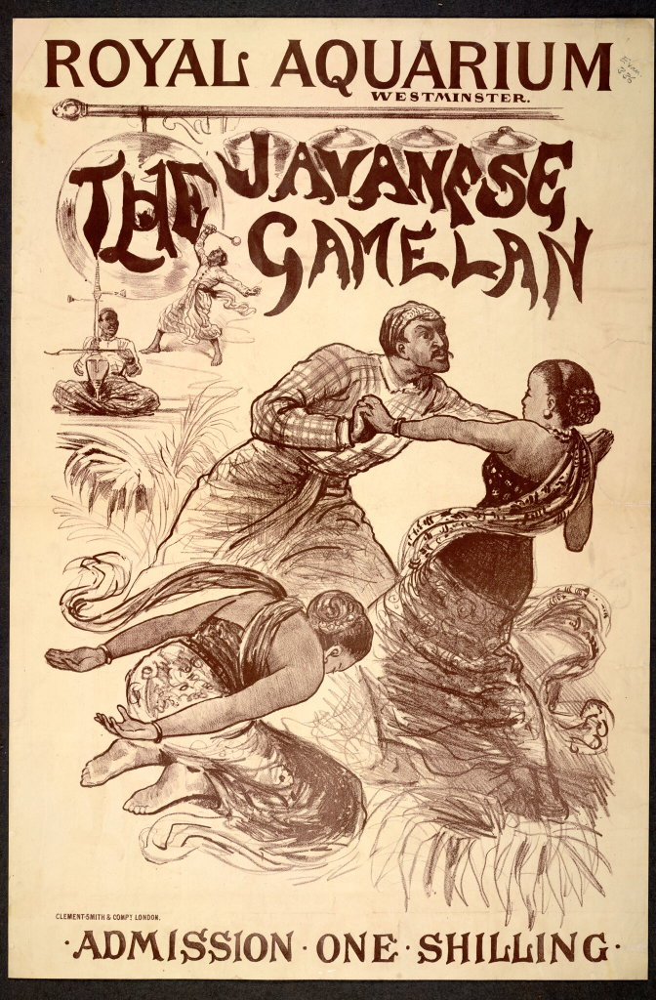
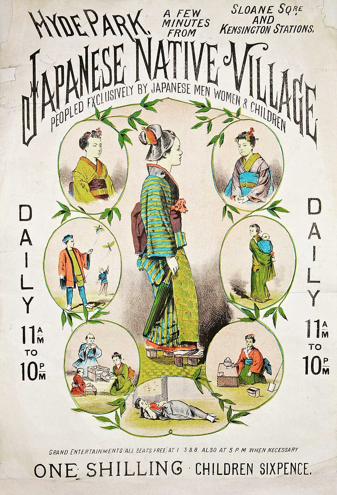
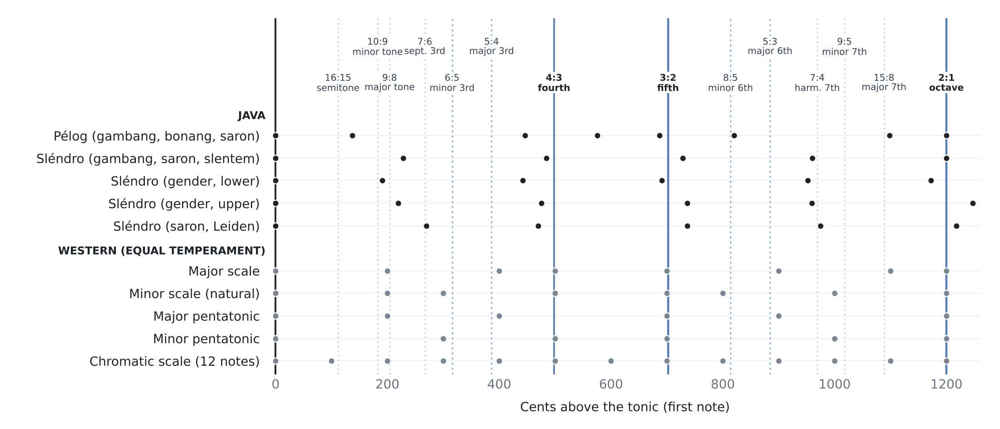
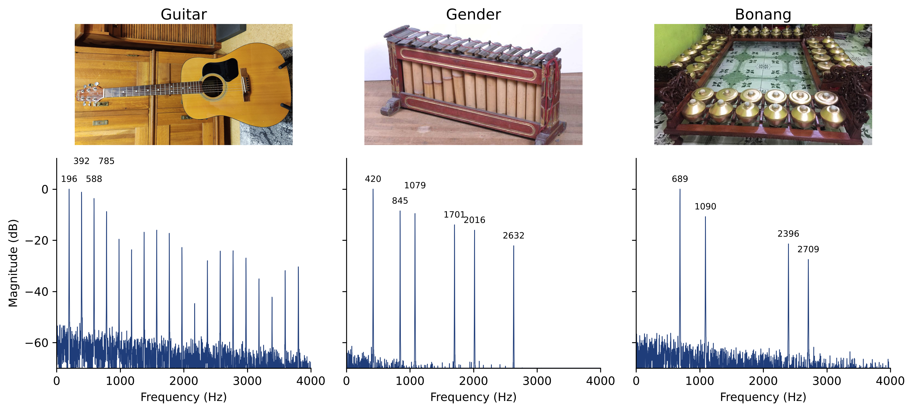
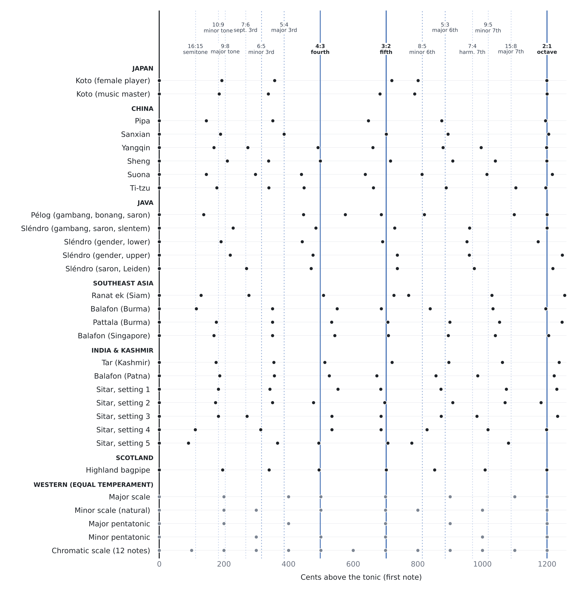
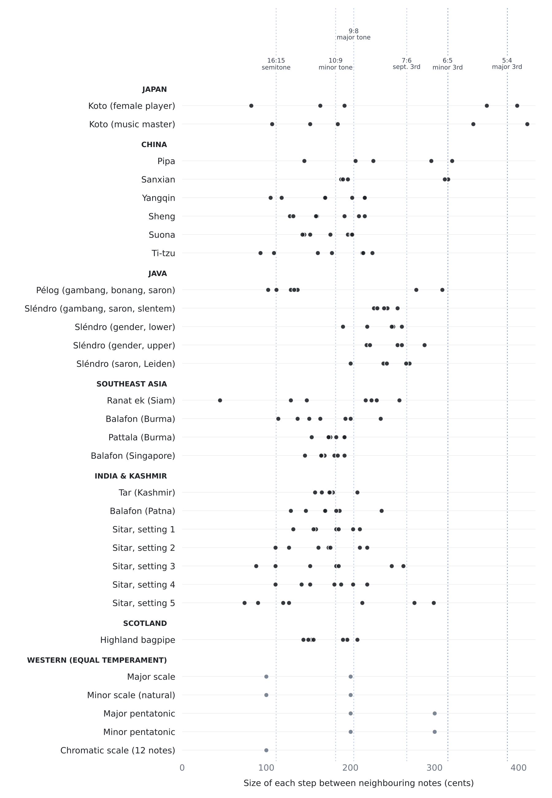
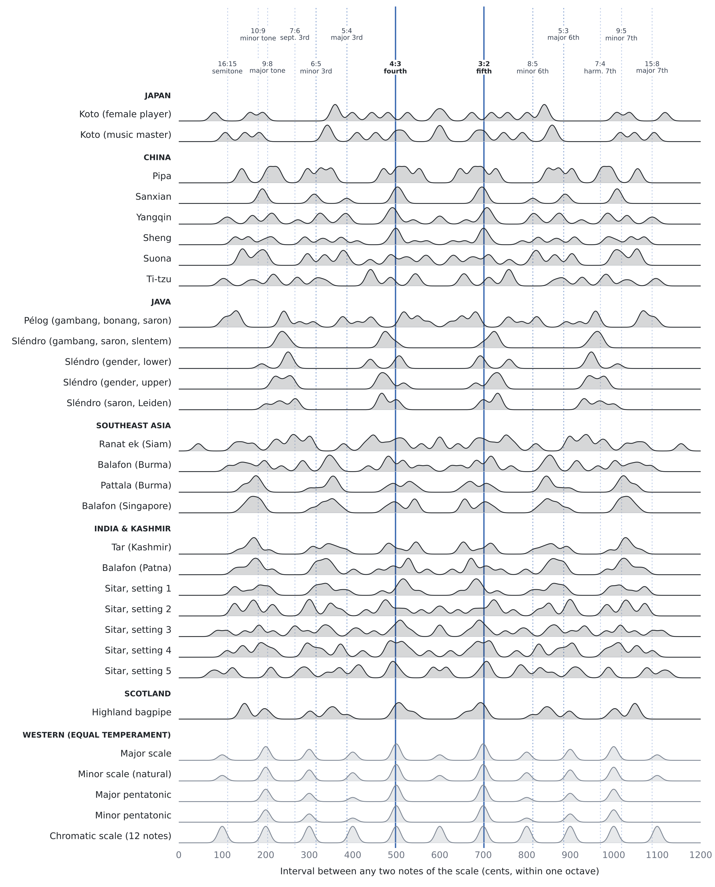
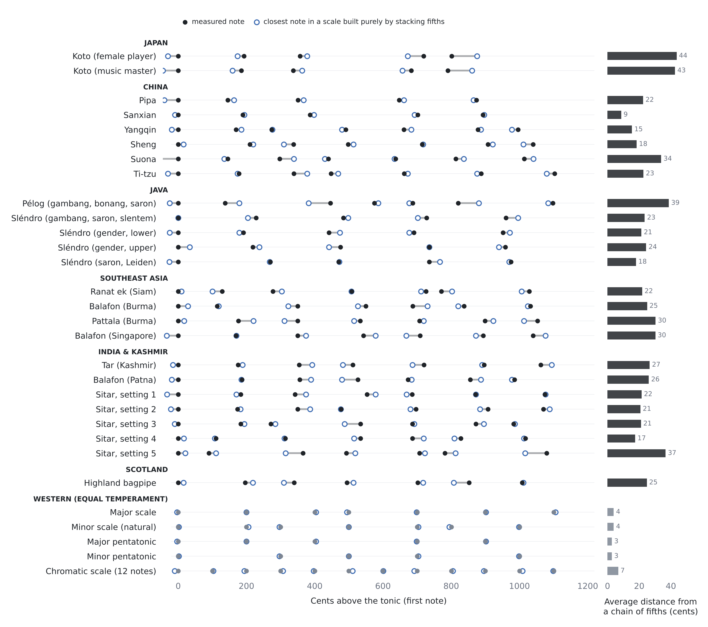

The late 19th century was a time when colonialism started to bring the music of far way lands to Europe, thus giving the public  opportunities to experience non-western music first hand.  The most well-known example is Claude Debussy's encounter with Sundanese (i.e., Western Javanese) gamelan at the 1889 Exposition Universelle in Paris[^1]. The music impressed him so profoundly that he wrote (after many years) that "...Javanese music is based on a type of counterpoint by comparison with which that of Palestrina is child's play."  But that level of appreciation was far from common.  A London pundit who visited a gamelan performance in 1882, for example, compared the bronze instruments to saucepans and the music to "noise made by the kitchen utensils of a Margate steamer in a storm"[^2].  Witnessing "savages" making music that they could barely understand, European scholars started to ponder: what does all of this say about our music and culture?

In this article, I want to share the story of an encounter that would lead to the birth of a new scholarly discipline - musicology.  It will have an impact on our understanding of music and sounds no less profound than that on Debussy. 

## A Javanese gamelan in a London aquarium

<figure style="float: left; margin: 0 1.5em 1em 0;">
  
</figure>

The [Royal Aquarium of Westminster](https://www.gsarchive.net/articles/sull_aquarium/index.html) opened in 1876  was perhaps one of the strangest spectacles that symbolised the decadence of _fin de siècle_ London.  Housed in a grandiose building that took up an entire block, just a short walk from the Westminster Abbey and Houses of Parliament, the Aquarium was originally conceived to be a grand venue for education, concerts and highbrow entertainment.  The great hall was designed to be surrounded by giant fish tanks for the visitors to enjoy the wonders of the ocean, but the ambitious plan didn't work out - there were very few fish in the tanks in the self-styled aquarium, and there was a bizarre attempt to house a beluga whale in the tanks.  The marine mammal sadly didn't last long. 

The venue was in constant financial troubles, and in just several years of operation, it gradually transitioned to something more like a carnival fairground, which regularly featured magic acts, stunts, animal shows, and competitions.  The Aquarium exhibited [Chang the Chinese Giant](https://en.wikipedia.org/wiki/Zhan_Shichai), among other human oddities for the amusement of Londoners.

<figure style="float: right; margin: 0 0 1em 1.5em;">
  
</figure>

The bizarre music and dancing from exotic lands was another form of popular attraction.  In 1882, 14 musicians and four singers were brought in from Yogyakarta, central Java to the Royal Aquarium for 3 months.  The public responses were mixed, to say the least. Some said that the singing of the female singer-dancers to be mere "screeching" and "groaning", and the gamelan music as "monotonous" and "apt to jar on ordinary English ears."[^2]

## The unexpected visitors with tuning forks

The gamelan at the Royal Aquarium put on 4 shows daily.  One day, in their off hours (most likely in the evening), a pair of visitors arrived at the Aquarium asking to speak to the Dutch supervisor.  The old gentleman, in perfect English annunciation, asked if they could check out the gamelan instruments and measure them. The request must have completely confounded the Dutch man. "You want to do _what_ with the instruments?" cried the Dutch, staring worriedly at a mysterious wooden box that he was carrying.

The old gentleman was [Alexander Ellis](https://en.wikipedia.org/wiki/Alexander_John_Ellis), an English polymath who is best known as a pioneer of modern phonetics. His passion in the understanding and documentation of the pronunciation of the English language would later inspire Bernard Shaw in the creation of the Professor Higgins character in [Pygmalion](https://en.wikipedia.org/wiki/Pygmalion_(play))[^3]. Ellis was trained in mathematics and had translated Hermann von Helmholtz's groundbreaking work in the perception of sound and music, _On the Sensations of Tone_, from German to English.  This was a publication of uttermost importance in our subject, and I'll have a lot to say about it later in this article.

Ellis was accompanied by a younger man, one [Mr. Hipkins](https://en.wikipedia.org/wiki/Alfred_James_Hipkins), who was sort of a man with an unusual superpower: a pair of legendarily sensitive ears.  He was an expert on piano tuning and was a music scholar. 

Confusion ensued due to the language barrier among the Javanese, the Dutch and the English, but eventually Ellis was able to explain that he wanted to measure the frequency of the individual sound that the gamelan instruments made, using the 100 precisely calibrated tuning forks[^4] that he brought in the wooden box.  For the next several hours, the Javanese watched, amused or confused, Mr. Hipkins listening intensely to the vibrations of the tuning forks as an assistant hit the bronze keys with a mallet.  Every time Mr. Hipkins nodded his head, Ellis excitedly wrote numbers down in a big notebook. 

It's one of the weirdest experiments of 19th-century science. Two English gentlemen listening to the strange and unfamiliar sounds of Javanese gamelan, late at night, in a giant "aquarium" at the heart of London.  This operation was a part of Alexander Ellis's multi-year project to systematically measure the sounds of instruments from all over the world.  What was so innovative about Ellis' research was the invention of a new unit of measurment called [cent](https://en.wikipedia.org/wiki/Cent_(music)), which allowed scholars to faithfully record the pitch of non-western music without the constraints imposed by the Western music notation.  It is a new scientific language that allowed scientists to talk and think about non-western music.

## "Field work" at the capital of the British Empire

Exhibitions of people from exotic parts of the world were sensational events in 19th century Europe, which regularly attracted millions of visitors. For example, the [1884 International Health Exhibition](https://en.wikipedia.org/wiki/International_Health_Exhibition) in London featured a large-scale "Chinese Court" with a full scale Chinese restaurant, a tea house, a pavilion, and a garden.  Six Chinese musicians mingled with the crowd and regaled them with "traditional Chinese music"[^5].  The Chinese musicians' rendition of _God Saves the Queen_ with Chinese instruments won enthusiastic applause. 

Of course, Ellis and Hapkins wouldn't miss the opportunity to observe Chinese musicians in action.  For 4 days, they talked to the musicians with the help of interpreters and repeated the measurements with tuning forks.

<figure style="float: right; margin: 0 0 1em 1.5em;">
  
</figure>

In 1887, the exotic beauty of Japanese culture was in rage in London.  Again, Ellis brought his tuning forks to the large-scale [Japanese Village](https://en.wikipedia.org/wiki/Japanese_Village,_Knightsbridge) constructed in Knightsbridge.

Hundreds years of British imperialism had made it possible for Ellis to assemble the first dataset of musical scales from a number of different cultures, while staying in London.  He invited a sitar player and a highland bag pipe player to his house for his measurements; he consulted scholarly publications, exchanged letters with experts overseas, and went to museums in London to examine exotic instruments. This grab-bag approach of data collection is problematic from today's point of view, but Ellis was practically inventing the quantitative research methodology as he went alone.  One of the important lessons that he learned was that treaties of non-Western music written by Western scholars and missionaries were often inaccurate, because the authors' understanding were biased by their Western music education.  Later researchers would take this lesson by heart and start to establish a new scholarly discipline centered on field work in the study of music.

## Universals in music?

Alexander Ellis was not merely a collector of exotic scales.  His goal was to prove a theoretical point - that Western music scales were derived from the laws of natures, and therefore was universal to all cultures[^6].  This was the dominant view of Europeans of the 19th century (and arguably still is today).  According to legend, Pythogoras in 6th century BC examined the sounds produced by plucking strings, and discovered that the most pleasant musical intervals are made by strings whose lengths are in simple integer ratio relationships. For example, halving the string gives the octave (2:1), two-thirds of the string gives the fifth (3:2), three-quarters of the string gives the fourth (4:3).  This discovery has led to the belief that the beauty of music lies in its origin in math and/or physics.  Since math and physics are universal, it follows that the scale of European classical music, which has been derived from Pythogoras-inspired ideas, must be _the_ musical scale.  The 17th century physicist Christian Huygens went as far as conjecturing that inhabitants of other planets must be able to enjoy classical music[^7].

A modern expression of this idea can be seen in this lecture, given by composer and conductor Leonard Bernstein in 1973[^8].  In this lecture, he presented his belief that physics of sounds is the foundation in which all cultures derive their music from (note that he didn't say that the Western scale is universal, but that it's constructed according to the same physics law that other cultures derived their music from).  The argument is that when a single note is played on an instrument like the piano, the string vibrates not just in the frequency associated with the pitch that we hear. Rather, physics dictates that the same string also vibrates at frequencies that are integer multiples of the root frequency. For example, the sound of note A contains the frequencies of 440 Hz, 880 Hz (A one octave higher), 1320 Hz (E)... and so on. This is called the _harmonic series_.  Bernstein claims that the harmonic series is the origin of the simple integer ratios discovered by Pythogoras, and can be used to derive the music scales of many cultures, including gamelan.  

It appears that he didn't bother to read the paper by Alexander Ellis, published almost a century ago...



## The variety of musical scales from around the world

> "The Musical Scale is not one, not 'natural', nor even founded 
> necessarily on the laws of the constitution of musical sound, 
> so beautifully worked out by Helmholtz, but very diverse, very 
> artificial, and very capricious."
>
> — Alexander J. Ellis, *On the Musical Scales of Various Nations*, 
> Journal of the Society of Arts, March 27, 1885, p. 526

Shockingly, in Ellis' landmark 1885 publication, he argued that the scales used in non Western music are not like Western scales, and they are not corrupted or truncated version a universal Western scale. Rather, they deliberately contain intervals not found in Western music.  One striking example is the appearance of an interval sitting between the major 3rd and the minor 3rd in many cultures.  This _neutral third_ was not a tuning error - it's an aesthetic choice, giving the music a distinctive flavour that we tend to associate with the Middle East.

Scales around the world are also _diverse_. Take pentatonic scales, for example.  Although many cultures choose to use 5-tone scales, there are different types of pentatonic scales, each with distinctive characteristics.  Ellis found a Chinese three-stringed guitar tuned a scale that closely matches the major pentatonic scale used in Blues, but you wouldn't mistake it with the Japanese [Hirajōshi](https://en.wikipedia.org/wiki/Hirajōshi_scale) pentatonic scale, because Hirajōshi has intervals smaller than a whole tone, giving it an elegant feel.  The Slendro tuning in gamelan is also 5-tone, but it's built with an entirely different principle. We'll examine it in more detail later.

In addition, Ellis concluded that music scales are  _artificial_ - meaning that they are not always constructed according to the mathematical or acoustical principles known to the West.  From Fig. A1 in the Appendix, you can see that the intervals in Ellis' measurement are often not aligned with the integer ratios favored by Western music - in direct contradiction to Bernstein's argument.

And finally, Ellis said that music scales are _capricious_ - meaning that the intervals are not always fixed.  He observed that in many cultures, the intervals that make up a scale can evolve over time, and can even vary from performers to performers, or from compositions to compositions.  The concept of standardized scale appears to be a very Western one (and a fairly recent one).

## The strange tuning of gamelan

The crown jewel of Ellis' paper is the gamelan data collected at the Royal Aquarium, because this data avoids some of the most significant methodological problems in other sections of Ellis' paper.  The gamelan instruments were played correctly, they were in good working conditions, and the measurements were precise and were repeated for different instruments in the ensemble.  Most of his observations still hold up today.

<figure style="margin: 2em 0;">
  
  <figcaption style="font-size: 0.9em; color: #6b7280; margin: 0.5em 0 0; text-align: center;">
    Fig. 1: The frequencies of measured notes of gamelan instruments, expressed as intervals relative to the lowest note in the unit of cents.  The frequencies of some entries are averaged across multiple instruments.  The frequencies for Western scales are theoretical, not measured.  Note that they deviate from the simple integer ratios because the scales are in equal temperament. Data courtesy of the <a href="https://github.com/jomimc/DaMuSc">Database of Musical Scales</a>.
  </figcaption>
</figure>

In terms of diversity, Ellis observed that Javanese gamelan used two entirely different tuning systems, called sléndro and pélog. The instruments for the two systems are not exchangeable; they have different repertoire, although one single performance can feature compositions from both systems.  The is very little overlap between the notes in the two systems.  Sléndro is a pentatonic scale which roughly divides an octave into 5 equal parts, whereas pélog is a 7-note system consisting of very small intervals and very big intervals (see Fig. A2 in the Appendix). The 7 note in Pélog tuning are not employed all at once in a composition. Rather, certain 5-note subsets are used.  This is quite different from Western music, where all compositions are based on one theoretical construct (at least up to the late 19th century).

The two tuning systems must seem completely arbitrary to Ellis, because the notes don't appear to follow any rational principles known to Europeans at that time.  The frequencies are in general do not appear to be aligned with intervals of simple integer ratios.  The perfect 4th and 5th intervals, which are prominent in Western music because they are considered harmonious to Europeans, are not obviously present, and the sléndro scale includes a note whose relationship with the root note can expressed as 7:4 (the harmonic 7th).  It's a relatively simple integer ratio, but it's a ratio that is absent in Western music.

Another head scratcher is the deviation from the Western concept of octave.  In other words, as you go up the scale, when the "same" note repeats, the frequency is not necessarily doubled.  It seems hard to understand from the Western perspective, but Ellis observed this phenomenon in other cultures as well (see Fig. A1 in the Appendix).

Finally, we come to capriciousness.  Sléndro and pélog are strictly speaking not scales in the western sense. Rather, they are rough guides.  Ellis compared his tuning data with another set of gamelan measurements made at Leiden, Netherlands, and noticed that while the tunings of individual instruments in the same gamelan ensemble are remarkably consistent (indicating that they are precisely tuned), two different ensembles can have significantly different interpretations of the sléndro and the pélog.  Modern large scale comparisons show that the variation is a consistent feature of the gamelan culture[^9].  

## The strange sound of gamelan

It's intriguing that Alexander Ellis said that scales are _artificial_, which I interpret to mean unexplainable by rational principles known to Europeans of the 19th century.  We are now living almost 150 years after Ellis' discovery.  With advances in our understanding of sound and perception, some of artificiality has become less mysterious.  

Gamelan is different from Western music not just in the scales that it is based on, or the culture that produces it. An important difference is in the sound itself.  The characteristics of the sound of gamelan is so fundamentally different from Western music that when Parisian musicians encountered gamelan in the 1889 World’s Fair (the same exposition that exposed Debussy to gamelan), the couldn't agree on the identity of the notes that they heard[^1].

<figure style="margin: 2em 0;">
  
  <figcaption style="font-size: 0.9em; color: #6b7280; margin: 0.5em 0 0; text-align: center;">
    Fig. 2: Sample frequency spectra of the guitar compared to two gamelan instruments. The spectra are adapted from <i>Tuning, Timbre, Spectrum, Scale</i> (2 eds.) by William Sethares (2005). Photos are from the Wikipedia.
  </figcaption>
</figure>

Left panel of Fig. 2 shows the compositions of a plucked guitar note. As Bernstein explained in his lecture, it is composed of multiple frequencies, which are integer multiples of the fundamental frequency.  This is the harmonic series, which Bernstein believed was universal to the music of all cultures.  Where does the integer relationship come from? It is dictated by the physics of vibrating strings or blown tubes.  In Western classical music, it is the physics behind most of the instruments.  

However, not all music instruments are based on strings or wind.  The middle and the right panels of Fig. 2 illustrate two significant instruments in a Javanese gamelan ensemble: a _gender_ and a _bonang_.  The gender is an instrument with bronze keys amplified by bamboo resonantors, and the bonang is a set of small bronze kettle gongs. Both are percussive instruments played by mallets.  You can hear the sounds of these instruments in the videos below:

  <iframe style="flex:1 1 300px; aspect-ratio:16/9; border:0;"
          src="https://www.youtube-nocookie.com/embed/xJNGfPmjQLw"
          title="YouTube video" loading="lazy" allowfullscreen
          allow="accelerometer; autoplay; clipboard-write; encrypted-media; gyroscope; picture-in-picture"></iframe>
  <iframe style="flex:1 1 300px; aspect-ratio:16/9; border:0;"
          src="https://www.youtube-nocookie.com/embed/nZ74P-Rgvyg"
          title="YouTube video" loading="lazy" allowfullscreen
          allow="accelerometer; autoplay; clipboard-write; encrypted-media; gyroscope; picture-in-picture"></iframe>

The spectra in Fig. 2 show that the compositions of gamelan instruments are fundamentally different from the harmonic series that Bernstein and many music teachers say are universal to all instruments.  There are still fundamental and harmonics, but they are no longer in integer relationships.  As in Western instruments, the spectra are dictated by physics. They are no less natural than the sound of Western instruments.  They are merely not made of strings or tubes.

The distinction is important.  Sounds composed of harmonic series are called _harmonic sounds_. Those that are not are called _inharmonic sound_. 

This shouldn't be suprising to Ellis, because the composition of sounds had already been studied in details by the late 19th century.  In particular, [Hermann von Helmholtz](https://en.wikipedia.org/wiki/Hermann_von_Helmholtz), the German physiologist and physicist, used a [scientific instrument](https://en.wikipedia.org/wiki/Helmholtz_resonance) that he invented to measure the spectral composition of sounds.  By 1863, he had already demonstrated that harmonci sounds are rare in nature.  However, he believed that inharmonic sounds are not musical, and therefore devoted his magnum opus [_On the Sensations of Tone_](https://en.wikipedia.org/wiki/Sensations_of_Tone) to the perception of harmonic sounds.  This research was done before the first known gamelan performance in Europe (in the 1879 Colonial and National Trade Exhibition in Arnhem).  If Helmholtz had the opportunity to hear a gamelan performance, perhaps his research would have taken a different direction.

## The insights of Hermann von Helmholtz

## Appendix: Observations of Ellis' measurements

Alexander Ellis' 1885 publication tabulated a large number of scales compiled from multiple sources.  Some are idealised scales derived from theoretical publications. Here, we only take a quick look at some of the data that he and his correspondents actually measured from instruments[^10].

First, in Fig. A1, we look at the frequencies of the notes in a scale relative to the root note. The frequencies are expressed in the unit of _cents_ invented by Ellis.  An octave is divided equally into 1200 cents. A semitone is 100 cents.  For most listeners, deviations of 20–30 cent	sounds noticeably out of tune.

At the top of the plot, I also added the frequency ratios of the intervals.  The simplest ratios are prominent in Western music theory (2:1 for octave, 3:2 for the perfect fifth, and 4:3 for the perfect fourth) - they are marked by bold vertical lines.  The Western scales in the figure are equally tempered, so the notes do not always land precisely on the intervals of integer ratios, but the fourth and the fifth are very close. 

Ellis' measurements of the Chinese three-stringed guitar [Sanxian](https://en.wikipedia.org/wiki/Sanxian) produced a pentatonic scale that matched the integer ratios closely, but it is far from the norm.  There is a weak tendency for notes to cluster around the perfect 4th and 5th intervals, but they very rarely land on 2:1, 3:2 and 4:3 exactly.  As we've noted previously, in several cultures, an "octave" (i.e., the next note after the last note in a scale) does not correspond to doubling of frequency. 

Ellis observed that intervals that fall between the major and the minor third is not uncommon - a clear violation of the expectation that musical intervals are based on simple integer ratios of frequencies.  In addition, pélog tuning in gamelan has a note close to the harmonic 7th (7:4 ratio). It is an interval that, despite is relatively simple ratio, is not used in Western music.

<figure style="margin: 2em 0;">
  
  <figcaption style="font-size: 0.9em; color: #6b7280; margin: 0.5em 0 0; text-align: center;">
    Fig. A1: The measured intervals between notes and the root note from Ellis (1885). Western scales in this figure are theoretical, not measured.
  </figcaption>
</figure>

Next, in Fig. A2, we look at the step sizes (i.e., intervals between successive notes).  Western scales (under equal temperament) are constructed with just two intervals, the whole and the half tone, but in other cultures, step sizes are more scattered. We already noted that gamelan tunings are quite unusual: sléndro's intervals are between a whole tone and a minor 3rd, whereas pélog tuning is a mixture of fairly small (around a half tone) and large intervals (slightly smaller than minor third).  In this plot, you can see that no other scale has these characteristics. 

<figure style="margin: 2em 0;">
  
  <figcaption style="font-size: 0.9em; color: #6b7280; margin: 0.5em 0 0; text-align: center;">
    Fig. A2: The measured intervals between successive notes from Ellis (1885). Western scales in this figure are theoretical, not measured.
  </figcaption>
</figure>

Fig. A3 plots the distributions of intervals from all pairs of notes in each scale.  You can see that although some none Western scales have prominent clusters around the perfect 4th and 5th, gamelan tunings' clusters deviate from them significantly.

<figure style="margin: 2em 0;">
  
  <figcaption style="font-size: 0.9em; color: #6b7280; margin: 0.5em 0 0; text-align: center;">
    Fig. A3: The measured intervals between pairs notes from Ellis (1885). Western scales in this figure are theoretical, not measured.
  </figcaption>
</figure>

Following Pythogoras, the perfect 5th interval is central to Western music theory.  The simple process of repeated applications of the perfect 5th interval yield a scale that is close to the tempered scale that modern listeners are familiar with.  The bottom rows of Fig. A4 below show that the averaged deviations are a couple of cents, which are undetectable to most people.  Most of the measurements by Ellis, however, do not fit with the Pythogoras model so well. Deviations larger than 20 cents are noticeably out of tune to most Western listeners.

<figure style="margin: 2em 0;">
  
  <figcaption style="font-size: 0.9em; color: #6b7280; margin: 0.5em 0 0; text-align: center;">
    Fig. A4: The deviations of measured notes from Ellis (1885) from theoretical scales constructed from the perfect fifth. Western scales in this figure are theoretical, not measured.
  </figcaption>
</figure>

## Sources

- About the Royal Aquarium, see the [article](https://www.gsarchive.net/articles/sull_aquarium/index.html) by John Sands. Also, _Performing Otherness: Java and Bali on International Stages, 1905-1952_ by Matthew Isaac Cohen (2010).

- The Japanese Village poster: from Wikipedia

[^1]: See [Sundanese Reverberances: Untangling Contradictions about the Gamelan Spectacle at the 1889 Paris World’s Fair](https://academic.oup.com/ml/article/106/1/58/7931576?guestAccessKey=c3e2c6b8-cf1f-4361-b34c-b00bd38da122&login=false), López-Lara & Chiantore (2025).

[^2]: _Performing Otherness: Java and Bali on International Stages, 1905-1952_ by Matthew Isaac Cohen (2010).

[^3]: No, Ellis didn't make people repeat the line "The rain in Spain stays mainly in the plain" endlessly, as Professor Higgins did in the musical adaptation of Shaw's play, because the prickly personality of the professor was based on another phonetician, Henry Sweet.

[^4]: Alexander Ellis's tuning forks are still preserved in a museum. You can view them [here](https://collection.sciencemuseumgroup.org.uk/objects/co5980/elliss-tuning-fork-tonometer).

[^5]: Unknown to Ellis, the performers in the 1884 Health Exhibition were not the kind of classical Chinese musicians that he had assumed. The performers were in fact [Manchu](https://en.wikipedia.org/wiki/Manchu_people)s from the capital of the Chinese empire.  The music that they performed was popular in the capital of China, but they were Manchurian and even Mongolian in origin. See [this article](https://www.researchbank.ac.nz/server/api/core/bitstreams/6cb76be1-4b1b-492b-829e-b2ed4f2f7f64/content).

[^6]: Just several years before Ellis' measurement project, he published a [pamphlet](https://babel.hathitrust.org/cgi/ssd?id=hvd.32044041028812&seq=4) arguing for a universalist position. 

[^7]: See the texbook _Tuning, Timbre, Spectrum, Scale_ (2 eds.) by William Sethares (2005).

[^8]: Bernstein's argument is obviously not new. It is based on the theory of [Jean-Philippe Rameau](https://en.wikipedia.org/wiki/Jean-Philippe_Rameau), the 18th century musician and theorist, but married with the linguistics of Noam Chomsky.

[^9]: See, for example, [Balinese Gamelan Tuning: The Toth Archives](https://journal.iftawm.org/previous/vol9no2/vitale-sethares/) Vitale & Sethares (2021)

[^10]: For this exercise, I used digitized version of Ellis' measurements in the [Database of Musical Scales](https://github.com/jomimc/DaMuSc), with some errors corrected.  Each row is not necessarily measured from one single instrument - Ellis frequently listed averaged values from multiple instruments.  In some situations, measurements of the same instruments can be broken into multiple entries.  Also, the entries are not necessarily scales.  They can be a collection of notes whose subsets form scales.  In this article, I use the term scale loosely.
