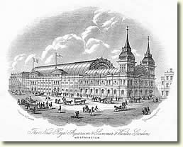
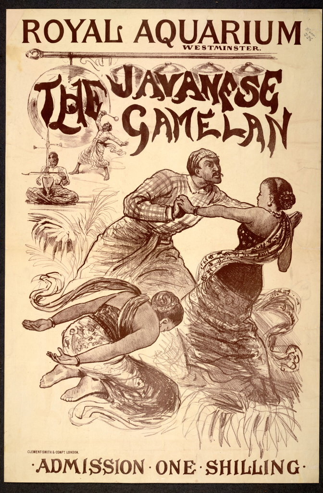

If you were asked to put together a playlist for an alien civilisation, what would you choose? In 1977, two Voyager spacecraft were launched, each carrying a [golden record](https://en.wikipedia.org/wiki/Contents_of_the_Voyager_Golden_Record) containing the sights and sounds of planet Earth.  Many people know that Chuck Berry's _Johnny B. Goode_ made the cut, but do you know what else is on it?  Take a listen [here](https://www.youtube.com/watch?v=ELnn9V01EiI).  Starting from the beginning, we hear greetings in dozens of languages, followed by the sounds of animals and the natural world. Around the 30-minute mark, something new begins: what we Earthlings call music. We are treated to the first movement of Bach's _Brandenburg Concerto No. 2_, and then the familiar sound of the Western orchestra gives way to something most people have never heard:



This is gamelan music, played on an ensemble of mostly bronze gongs and metallophones. It was recorded by American musicologist [Robert E. Brown](https://en.wikipedia.org/wiki/Robert_E._Brown) at the royal court in Yogyakarta, Java, in 1971.  This composition, titled _Ketawang Puspawarna_ (roughly, "flowers of many kinds"), is a small taste of a musical tradition that has been evolving for more than a thousand years. It is also just one of many musical traditions on the record.

To human ears, these two tracks sound dramatically different.  Some listeners can appreciate the artistic sophistication in both.  Others find nothing familiar to hold on to and regard _Puspawarna_ as nothing more than a curiosity.

That brings us to the question of universals in music.  How much of our appreciation of music is tied to a specific culture, on a specific planet?  It's often said that music is a universal language. The 17th-century physicist Christiaan Huygens went so far as to suggest that inhabitants of other planets would be able to enjoy European classical music[^1].  His thinking rested on the belief that beauty in music came from the laws of nature.  Since any rational being could grasp those laws, good music should transcend culture, perhaps even across the galaxy.  If so, an alien would surely enjoy Bach. But what would it make of _Puspawarna_? To put it another way: why does the music on the record sound so different?  Is there a deep, hidden principle beneath the differences, or is music as varied as the cultures that made it?

This is the first of a three-part series about diversity and universals in music.  In Part 1, we'll look at one of the earliest European attempts to examine music from across the world.  It's the story of musicologist Alexander Ellis, who undertook a multi-year project to test whether musical scales around the world could be derived from universal principles.  In [Part 2](), we'll see how the data that he collected in the late 19th century overturned his own hypothesis, with the unusual scales used in gamelan playing an important role.  And finally, in [Part 3](), we'll meet Ellis's contemporary, the German physicist and physiologist Hermann von Helmholtz, whose work points to a different view: that musical diversity is shaped by culture but constrained by the way humans perceive sound.  In this view, if there is a universal in music, it is human perception.

## A Javanese gamelan in a London aquarium

The late 19th century was a turning point in how Europeans understood music.  It was a time when colonialism started to bring the music of faraway lands to Europe, thus giving the public opportunities to experience non-Western music first-hand.  The best-known example is Claude Debussy's encounter with Sundanese gamelan (from West Java) at the 1889 Exposition Universelle in Paris[^2]. The music impressed him so profoundly that more than 20 years later he wrote: "Javanese music is based on a type of counterpoint by comparison with which that of Palestrina is child's play."  But that level of appreciation was far from common.  A London critic who attended a gamelan performance in 1882 (one we'll return to shortly) compared the bronze instruments to saucepans and the music to "noise made by the kitchen utensils of a Margate steamer in a storm"[^3].

<figure style="float: left; margin: 0 1.5em 1em 0;">
  
</figure>

The [Royal Aquarium of Westminster](https://www.gsarchive.net/articles/sull_aquarium/index.html), which opened in 1876, became one of the strangest symbols of fin-de-siècle London's decadence.  Housed in a grandiose building that took up an entire block, just a short walk from Westminster Abbey and the Houses of Parliament, the Aquarium was originally conceived as a venue for education, concerts and highbrow entertainment.  The great hall was meant to be surrounded by giant fish tanks to display the wonders of the ocean, but the plan never quite worked out: there were very few fish in the self-styled aquarium, and there was a bizarre attempt to keep a beluga whale.  Sadly, the marine mammal didn't last long. 

The venue was in constant financial trouble, and within a few years, it had become something closer to a fairground, which regularly featured magic acts, stunts, animal shows and competitions.  The Aquarium exhibited [Chang the Chinese Giant](https://en.wikipedia.org/wiki/Zhan_Shichai), among other human oddities for the amusement of Londoners.

<figure style="float: right; margin: 0 0 1em 1.5em;">
  
</figure>

The bizarre music and dancing from exotic lands were another form of popular attraction.  In 1882, 14 musicians and 4 singers were brought in from Yogyakarta, central Java, to the Royal Aquarium for three months.  The public's responses were mixed, to say the least.  Some dismissed the singing of the female singer-dancers as mere "screeching" and "groaning", and the gamelan music as "monotonous" and "apt to jar on ordinary English ears"[^3].

## The unexpected visitors with tuning forks

The gamelan at the Royal Aquarium put on four shows daily.  One day, in their off hours (most likely in the evening), a pair of visitors arrived at the Aquarium asking to speak to the Dutch supervisor.  The old gentleman, in impeccably enunciated English, asked if they could examine the gamelan instruments and measure them. The request must have completely confounded the Dutchman. "You want to do _what_ with the instruments?" he cried, eyeing worriedly a mysterious wooden box that the visitors had brought with them.

The old gentleman was [Alexander Ellis](https://en.wikipedia.org/wiki/Alexander_John_Ellis), an English polymath who is best known as a pioneer of modern phonetics. His passion for understanding the pronunciation of the English language would later help inspire Bernard Shaw's Professor Higgins in [_Pygmalion_](https://en.wikipedia.org/wiki/Pygmalion_(play))[^4]. Ellis was trained in mathematics and had translated Helmholtz's groundbreaking work on the perception of sound and music, _On the Sensations of Tone_, into English.  This book is central to our story, and I'll have much more to say about it later in [Part 3]() of this series.

Ellis was accompanied by a younger man, [Alfred Hipkins](https://en.wikipedia.org/wiki/Alfred_James_Hipkins), who had an unusual superpower: a pair of legendarily sensitive ears.  A piano tuner at the famous Broadwood firm and a respected scholar of old instruments, he could hear differences in pitch that most people would miss.

Confusion ensued due to the language barrier, but eventually Ellis was able to explain that he wanted to measure the pitch of each note the gamelan instruments made, using the 100 precisely calibrated tuning forks[^5] that he had brought in the wooden box.  For the next several hours, the Javanese watched, amused or bewildered, as Hipkins listened intently, comparing each note an assistant struck on the bronze keys against the tuning forks until he found a match. Every time Hipkins nodded, Ellis excitedly wrote numbers down in a big notebook. 

It's one of the oddest experiments of 19th-century science. Two English gentlemen listening to the strange sounds of Javanese gamelan, late at night, in a giant "aquarium" in the heart of London.  This session was a part of Ellis's multi-year project to systematically measure the sounds of instruments from all over the world.  His innovation was a new unit of measurement called the [cent](https://en.wikipedia.org/wiki/Cent_(music)).  With it, scholars could record the tuning of non-Western music faithfully, without forcing it into Western notation. In effect, Ellis had given them a new language for talking and thinking about the world's music.

## "Fieldwork" in the capital of the British Empire

Exhibitions of people from exotic parts of the world were sensational events in 19th-century Europe. They regularly attracted millions of visitors. For example, the [1884 International Health Exhibition](https://en.wikipedia.org/wiki/International_Health_Exhibition) in London featured a large-scale "Chinese Court" with a restaurant, a tea house, a pavilion and a garden.  Six Chinese musicians mingled with the crowd and regaled them with "traditional Chinese music"[^6].  The musicians' rendition of _God Save the Queen_ on Chinese instruments won enthusiastic applause. 

Of course, Ellis and Hipkins weren't about to miss this chance.  For four days, they talked to the musicians through interpreters and took the same tuning-fork measurements as they had done with the gamelan.

<figure style="float: right; margin: 0 0 1em 1.5em;">
  
</figure>

In 1887, the exotic beauty of Japanese culture was all the rage in London.  Once again, Ellis brought his tuning forks to the [Japanese Village](https://en.wikipedia.org/wiki/Japanese_Village,_Knightsbridge) constructed in Knightsbridge, where around a hundred Japanese residents worked and performed for paying visitors.

Centuries of British imperialism had made it possible for Ellis to assemble the first dataset of musical scales from many cultures, without leaving London.  He invited a sitar player and a Highland bagpipe player to his house; he consulted scholarly publications, exchanged letters with experts overseas and went to museums in London to examine exotic instruments. This grab-bag approach to data collection is problematic from today's point of view, but Ellis was practically inventing the quantitative research methodology as he went along.  

One of the important lessons that he learned was that treatises on non-Western music written by Western scholars and missionaries were often inaccurate, because the authors' understanding was biased by their music education.  Later researchers would take this lesson to heart, building a new scholarly discipline centred on fieldwork: what we now call ethnomusicology.

## Universals in music?

Alexander Ellis was not merely a collector of exotic scales.  His goal was to prove a theoretical point: that Western musical scales were derived from the laws of nature, and therefore were universal to all cultures[^7].  This was the dominant view of Europeans of the 19th century (and arguably still is today).  

According to legend, Pythagoras in the 6th century BC examined the sounds produced by plucking strings and discovered that the most pleasant musical intervals are made by strings whose lengths are in simple integer ratio relationships. For example, halving the string gives the octave (2:1), two-thirds of the string gives the fifth (3:2) and three-quarters of the string gives the fourth (4:3).  This discovery led to the belief that the beauty of music is rooted in mathematics or physics.  Since mathematics and physics are universal, it seemed to follow that the scale of European classical music, built on Pythagorean ideas, must be _the_ musical scale.  

In [Part 2](), we will see how Ellis's own data proved him wrong.



## Sources

- About the Royal Aquarium, see the [article](https://www.gsarchive.net/articles/sull_aquarium/index.html) by John Sands. Also, _Performing Otherness: Java and Bali on International Stages, 1905--1952_ by Matthew Isaac Cohen (2010).

- The Japanese Village poster: from Wikipedia

[^1]: See the textbook _Tuning, Timbre, Spectrum, Scale_ (2nd ed.) by William Sethares (2005).

[^2]: See [Sundanese Reverberances: Untangling Contradictions about the Gamelan Spectacle at the 1889 Paris World's Fair](https://academic.oup.com/ml/article/106/1/58/7931576), López-Lara & Chiantore (2025).

[^3]: _Performing Otherness: Java and Bali on International Stages, 1905--1952_ by Matthew Isaac Cohen (2010).

[^4]: No, Ellis didn't make anyone repeat "The rain in Spain stays mainly in the plain", as Professor Higgins does in _My Fair Lady_, the musical adaptation of Shaw's play. Higgins' prickly personality was modelled mainly on another phonetician, Henry Sweet.

[^5]: Alexander Ellis's tuning forks are still preserved in a museum. You can view them [here](https://collection.sciencemuseumgroup.org.uk/objects/co5980/elliss-tuning-fork-tonometer).

[^6]: Unknown to Ellis, the performers at the 1884 Health Exhibition were not the classical Chinese musicians that he had assumed. They were [Manchu](https://en.wikipedia.org/wiki/Manchu_people)s from the capital of the Chinese empire.  The music that they performed, although popular in northern China, had Manchurian and even Mongolian roots. See [this article](https://www.researchbank.ac.nz/server/api/core/bitstreams/6cb76be1-4b1b-492b-829e-b2ed4f2f7f64/content).

[^7]: A few years before his measurement project, Ellis published a [pamphlet](https://babel.hathitrust.org/cgi/ssd?id=hvd.32044041028812&seq=4) arguing for a universalist position. 

