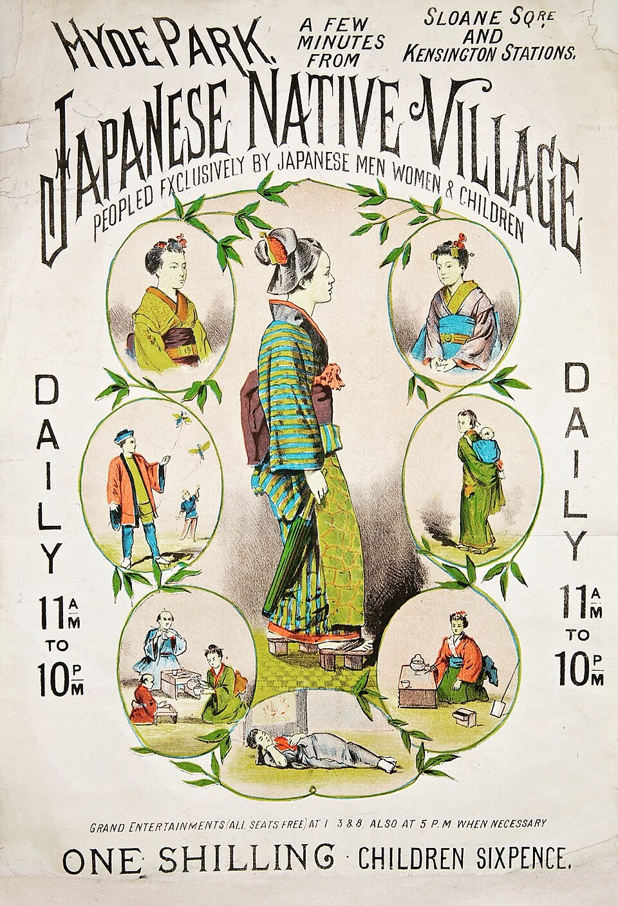

If you are asked to curate a collection of music for the enjoyment of an alien civilization, what music would you select in this collection?  In 1977, two voyager spacecrafts were launched into space, each carrying a [golden disc](https://en.wikipedia.org/wiki/Contents_of_the_Voyager_Golden_Record) containing the sights and sounds of planet Earth.  Many people heard that Chuck Berry's _Johnny B. Goode_ is on the disc, but do you know what else is also on the disc?  Let's give it a listen [here](https://www.youtube.com/watch?v=ELnn9V01EiI).  Starting from the beginning, we hear greetings in various languages, which is then followed by sounds of animals and the nature environment. At around the 30-minute mark, we suddenly recognize something different: It's an artistic expression that we called music on Earth. We are treated with a section of _Brandenburg Concertos_ by Johann Sebastian Bach, and then, the familiar sound of the Western orchestra is replaced by something far less familiar to most people reading this article:



It is a piece of _gamelan_, recorded by American musicologist [Robert E. Brown](https://en.wikipedia.org/wiki/Robert_E._Brown) at the royal palace of Jogyakarta, Java in 1971.  This composition, titled _Ketawang Puspawarna_ (javanese word meaning "flowers of many kinds"), is a small sample from a music tradition that has been in continuous development for more than a thousand years - one of the many that are included in the golden disc.

From the perspective of human listeners, these two tracks sound dramatically different.  Some listeners can appreciate the sophistication in both, seeing both as examples of artistic expression at the highest level.  Others - especially those with little prior exposure to gamelan - fail to hear the familiar sounds and their associated emotional/social meanings, and regard _Puspawarna_ as nothing more than a curiosity.

That brings us to the question of universals in music.  How much of our appreciation of music is tied to a specific culture, on a specific planet?  It's often said that music is a universal language. The 17th century physicist Christian Huygens went as far as conjecturing that inhabitants of other planets must be able to enjoy classical music[^1], based on the then popular belief that beauty in music has its origin in the laws of nature, which must be recognizable by all rational beings and therefore can be expected to transcend culture (maybe at galactic scale).  If we follow this line of reasoning, wouldn't it be pointless to include _Puspawarna_ in the golden disc?  Or, put in a different way, why do music on the disc sound so different?  Are they variations of some hidden, deep universal principles, or are just as different as human cultures?

This is the first of a 3-part series about the diversity and universal in music.  In Part 1, we'll look at one of Europeans' earliest attempts to examine the diversity of music across the world.  It's the story of musicologist Alexander Ellis, who undertook a multi-year project to test if musical scales around the world could be derived from universal principles.  In Part 2, we'll see that the data that he collected in late 19th century shockingly refuted the hypothesis.  The unusual scales used in gamelan played an important role.  And finally in Part 3, we turned to a different point of view, which also originated in the 19th century, to see that the diversity of music is probably best understood as a process driven by cultural factors but under the constraints of human psychology.  If there is universal in music, it is the human mind.

## A Javanese gamelan in a London aquarium

The late 19th century was a critical time in our modern understanding of music.  It's a time when colonialism started to bring the music of far way lands to Europe, thus giving the public opportunities to experience non-western music first hand.  The most well-known example is Claude Debussy's encounter with Sundanese (i.e., Western Javanese) gamelan at the 1889 Exposition Universelle in Paris[^2]. The music impressed him so profoundly that he wrote that "...Javanese music is based on a type of counterpoint by comparison with which that of Palestrina is child's play."  But that level of appreciation was far from common.  A London pundit who visited a gamelan performance in 1882, for example, compared the bronze instruments to saucepans and the music to "noise made by the kitchen utensils of a Margate steamer in a storm"[^3].  

In this article, we'll focus on one of such encounters.

<figure style="float: left; margin: 0 1.5em 1em 0;">
  
</figure>

The [Royal Aquarium of Westminster](https://www.gsarchive.net/articles/sull_aquarium/index.html) opened in 1876  was perhaps one of the strangest spectacles that symbolised the decadence of _fin de siècle_ London.  Housed in a grandiose building that took up an entire block, just a short walk from the Westminster Abbey and Houses of Parliament, the Aquarium was originally conceived to be a grand venue for education, concerts and highbrow entertainment.  The great hall was designed to be surrounded by giant fish tanks for the visitors to enjoy the wonders of the ocean, but the ambitious plan didn't work out - there were very few fish in the tanks in the self-styled aquarium, and there was a bizarre attempt to house a beluga whale in the tanks.  The marine mammal sadly didn't last long. 

The venue was in constant financial troubles, and in just several years of operation, it gradually transitioned to something more like a carnival fairground, which regularly featured magic acts, stunts, animal shows, and competitions.  The Aquarium exhibited [Chang the Chinese Giant](https://en.wikipedia.org/wiki/Zhan_Shichai), among other human oddities for the amusement of Londoners.

<figure style="float: right; margin: 0 0 1em 1.5em;">
  
</figure>

The bizarre music and dancing from exotic lands was another form of popular attraction.  In 1882, 14 musicians and four singers were brought in from Yogyakarta, central Java to the Royal Aquarium for 3 months.  The public responses were mixed, to say the least. Some said that the singing of the female singer-dancers to be mere "screeching" and "groaning", and the gamelan music as "monotonous" and "apt to jar on ordinary English ears."[^3]

## The unexpected visitors with tuning forks

The gamelan at the Royal Aquarium put on 4 shows daily.  One day, in their off hours (most likely in the evening), a pair of visitors arrived at the Aquarium asking to speak to the Dutch supervisor.  The old gentleman, in perfect English annunciation, asked if they could check out the gamelan instruments and measure them. The request must have completely confounded the Dutch man. "You want to do _what_ with the instruments?" cried the Dutch, staring worriedly at a mysterious wooden box that he was carrying.

The old gentleman was [Alexander Ellis](https://en.wikipedia.org/wiki/Alexander_John_Ellis), an English polymath who is best known as a pioneer of modern phonetics. His passion in the understanding and documentation of the pronunciation of the English language would later inspire Bernard Shaw in the creation of the Professor Higgins character in [Pygmalion](https://en.wikipedia.org/wiki/Pygmalion_(play))[^4]. Ellis was trained in mathematics and had translated Hermann von Helmholtz's groundbreaking work in the perception of sound and music, _On the Sensations of Tone_, from German to English.  This was a publication of uttermost importance in our subject, and I'll have a lot to say about it later in Part 3 of this series.

Ellis was accompanied by a younger man, one [Mr. Hipkins](https://en.wikipedia.org/wiki/Alfred_James_Hipkins), who was sort of a man with an unusual superpower: a pair of legendarily sensitive ears.  He was an expert on piano tuning and was a music scholar. 

Confusion ensued due to the language barrier among the Javanese, the Dutch and the English, but eventually Ellis was able to explain that he wanted to measure the frequency of the individual sound that the gamelan instruments made, using the 100 precisely calibrated tuning forks[^5] that he brought in the wooden box.  For the next several hours, the Javanese watched, amused or confused, Mr. Hipkins listening intensely to the vibrations of the tuning forks as an assistant hit the bronze keys with a mallet.  Every time Mr. Hipkins nodded his head, Ellis excitedly wrote numbers down in a big notebook. 

It's one of the oddest experiments of 19th-century science. Two English gentlemen listening to the strange and unfamiliar sounds of Javanese gamelan, late at night, in a giant "aquarium" at the heart of London.  This operation was a part of Alexander Ellis's multi-year project to systematically measure the sounds of instruments from all over the world.  What was so innovative about Ellis' research was the invention of a new unit of measurment called [cent](https://en.wikipedia.org/wiki/Cent_(music)), which allowed scholars to faithfully record the pitch of non-western music without the constraints imposed by the Western music notation.  It is a new scientific language that allowed scientists to talk and think about non-western music.

## "Field work" at the capital of the British Empire

Exhibitions of people from exotic parts of the world were sensational events in 19th century Europe, which regularly attracted millions of visitors. For example, the [1884 International Health Exhibition](https://en.wikipedia.org/wiki/International_Health_Exhibition) in London featured a large-scale "Chinese Court" with a full scale Chinese restaurant, a tea house, a pavilion, and a garden.  Six Chinese musicians mingled with the crowd and regaled them with "traditional Chinese music"[^6].  The Chinese musicians' rendition of _God Saves the Queen_ with Chinese instruments won enthusiastic applause. 

Of course, Ellis and Hapkins wouldn't miss the opportunity to observe Chinese musicians in action.  For 4 days, they talked to the musicians with the help of interpreters and repeated the measurements with tuning forks.

<figure style="float: right; margin: 0 0 1em 1.5em;">
  
</figure>

In 1887, the exotic beauty of Japanese culture was in rage in London.  Again, Ellis brought his tuning forks to the large-scale [Japanese Village](https://en.wikipedia.org/wiki/Japanese_Village,_Knightsbridge) constructed in Knightsbridge.

Hundreds years of British imperialism had made it possible for Ellis to assemble the first dataset of musical scales from a number of different cultures, while staying in London.  He invited a sitar player and a highland bag pipe player to his house for his measurements; he consulted scholarly publications, exchanged letters with experts overseas, and went to museums in London to examine exotic instruments. This grab-bag approach of data collection is problematic from today's point of view, but Ellis was practically inventing the quantitative research methodology as he went alone.  One of the important lessons that he learned was that treaties of non-Western music written by Western scholars and missionaries were often inaccurate, because the authors' understanding were biased by their Western music education.  Later researchers would take this lesson by heart and start to establish a new scholarly discipline centered on field work in the study of music.

## Universals in music?

Alexander Ellis was not merely a collector of exotic scales.  His goal was to prove a theoretical point - that Western music scales were derived from the laws of natures, and therefore was universal to all cultures[^7].  This was the dominant view of Europeans of the 19th century (and arguably still is today).  According to legend, Pythogoras in 6th century BC examined the sounds produced by plucking strings, and discovered that the most pleasant musical intervals are made by strings whose lengths are in simple integer ratio relationships. For example, halving the string gives the octave (2:1), two-thirds of the string gives the fifth (3:2), three-quarters of the string gives the fourth (4:3).  This discovery has led to the belief that the beauty of music lies in its origin in math and/or physics.  Since math and physics are universal, it follows that the scale of European classical music, which has been derived from Pythogoras-inspired ideas, must be _the_ musical scale.  

In the next part of the series, we'll look into how his hypothesis was refuted by his heroic effort in data collection.



## Sources

- About the Royal Aquarium, see the [article](https://www.gsarchive.net/articles/sull_aquarium/index.html) by John Sands. Also, _Performing Otherness: Java and Bali on International Stages, 1905-1952_ by Matthew Isaac Cohen (2010).

- The Japanese Village poster: from Wikipedia

[^1]: See the texbook _Tuning, Timbre, Spectrum, Scale_ (2 eds.) by William Sethares (2005).

[^2]: See [Sundanese Reverberances: Untangling Contradictions about the Gamelan Spectacle at the 1889 Paris World’s Fair](https://academic.oup.com/ml/article/106/1/58/7931576?guestAccessKey=c3e2c6b8-cf1f-4361-b34c-b00bd38da122&login=false), López-Lara & Chiantore (2025).

[^3]: _Performing Otherness: Java and Bali on International Stages, 1905-1952_ by Matthew Isaac Cohen (2010).

[^4]: No, Ellis didn't make people repeat the line "The rain in Spain stays mainly in the plain" endlessly, as Professor Higgins did in the musical adaptation of Shaw's play, because the prickly personality of the professor was based on another phonetician, Henry Sweet.

[^5]: Alexander Ellis's tuning forks are still preserved in a museum. You can view them [here](https://collection.sciencemuseumgroup.org.uk/objects/co5980/elliss-tuning-fork-tonometer).

[^6]: Unknown to Ellis, the performers in the 1884 Health Exhibition were not the kind of classical Chinese musicians that he had assumed. The performers were in fact [Manchu](https://en.wikipedia.org/wiki/Manchu_people)s from the capital of the Chinese empire.  The music that they performed was popular in the capital of China, but they were Manchurian and even Mongolian in origin. See [this article](https://www.researchbank.ac.nz/server/api/core/bitstreams/6cb76be1-4b1b-492b-829e-b2ed4f2f7f64/content).

[^7]: Just several years before Ellis' measurement project, he published a [pamphlet](https://babel.hathitrust.org/cgi/ssd?id=hvd.32044041028812&seq=4) arguing for a universalist position. 

