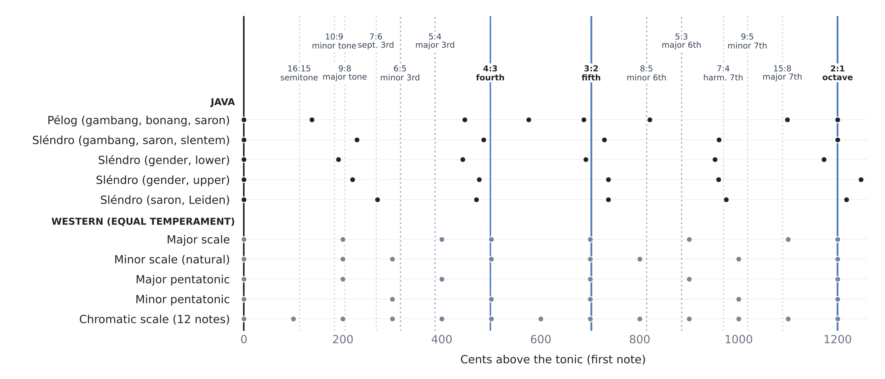
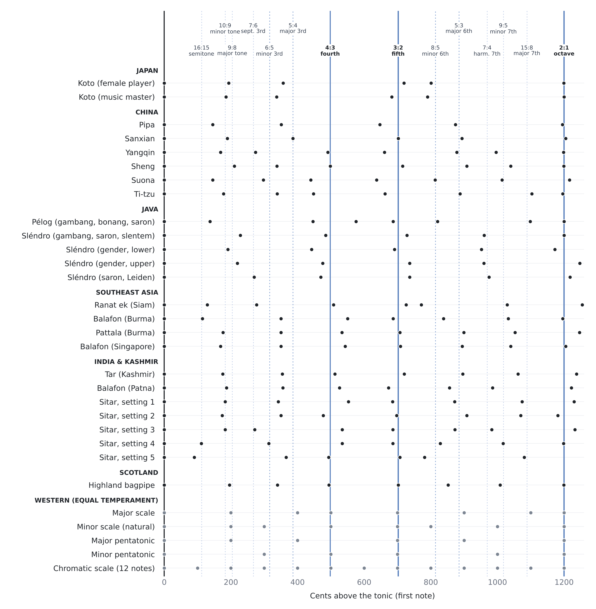

## Is physics the origin of universals in music?

In [Part 1]() of the series, we saw that the 19th century scholar Alexander Ellis set out to study scales - the fundamental building block of Western music - across different cultures, to test the idea that Western music scales were derived from the laws of natures, and therefore was universal to all cultures.  

A modern expression of this line of thinking can be seen in the lecture below, given by composer and conductor Leonard Bernstein in 1973[^1].  In this lecture, he presented his belief that physics of sounds is the foundation in which all cultures derive their music from. He didn't say that the Western scale is universal, but that it's constructed according to the same physics law that other cultures derived their music from.



Bernstein's argument is that when a single note is played on an instrument like the piano, the string vibrates not just in the frequency associated with the pitch that we hear. Rather, physics dictates that the same string also vibrates at frequencies that are integer multiples of the root frequency. For example, the sound of note A contains the frequencies of 440 Hz, 880 Hz (A one octave higher), 1320 Hz (E)... and so on. This is called the _harmonic series_.  Bernstein claims that the harmonic series is the origin of the simple integer ratios discovered by Pythogoras, and can be used to derive the music scales of many cultures, including gamelan.  

It appears that he didn't bother to read the paper by Alexander Ellis, published almost a century ago... 

## The diversity of musical scales

After years of tireless data collection, Ellis came to this surprising conclusion:

> "The Musical Scale is not one, not 'natural', nor even founded 
> necessarily on the laws of the constitution of musical sound, 
> so beautifully worked out by Helmholtz, but very diverse, very 
> artificial, and very capricious."
>
> — Alexander J. Ellis, *On the Musical Scales of Various Nations*, 
> Journal of the Society of Arts, March 27, 1885, p. 526

In non-specialist forums today, there are many articles and videos demonstrating how to play non Western scales on standard Western instruments, giving the impression that musical scales around the world are simply subsets of the Western scale.  Those are rough approximations.  In Ellis' landmark 1885 publication, he argued that the scales used in non Western music are not corrupted or truncated version a universal Western scale. Rather, they deliberately contain intervals not found in Western music (see the Appendix at the end of this article for details).  One striking example is the presence of an interval sitting between the major 3rd and the minor 3rd in many cultures.  This _neutral third_ is not a tuning error - it's an aesthetic choice, giving the music a distinctive flavour that we tend to associate with the Middle East.



However, the neutral third is not exclusive to the music of the Middle East.  Ellis was surprised when he heard it in the music of the Scotland highland.  

Another important discovery is that music scales are truly diverse, reflecting the aesthetics of the individual culture.  Take scales with 5 notes (i.d., _pentatonic scales_), for example.  Although many cultures use 5-tone scales, there are different types of pentatonic scales, each with distinctive characteristics.  Ellis found a Chinese three-stringed guitar ([Sanxian](https://en.wikipedia.org/wiki/Sanxian)) tuned a scale that closely matches the major pentatonic scale (one of the scaled used in Blues), but you wouldn't mistake it with the Japanese [Hirajōshi](https://en.wikipedia.org/wiki/Hirajōshi_scale) scale.  Unlike the major pentatonic scale, which consists of wide intervals (intervals larger than a whole step on the piano keyboard), the Hirajōshi scale has smaller intervals, giving it a particular flavour of Japanese elegant.  Europeans used to believe that the prevalent use of 5 tone scales in non Western cultures is because these primitive cultures failed to develop sensitivity and appreciation for fine intervals, but that is not what Ellis found in his data.



According Ellis' famous conclusion, music scales are _diverse_, _artificial_ and _capricious_.  In the next section, we'll examine what Ellis learned from his measurement of gamelan instruments to understand what he meant by those provocative words.

## The strange tuning of gamelan

The crown jewel of Ellis' paper is the gamelan data collected at the Royal Aquarium, because this data avoids some of the most significant methodological problems in other sections of Ellis' paper.  The gamelan instruments were played correctly, they were in good working conditions, and the measurements were precise and were repeated for different instruments in the ensemble.  Most of his observations still hold up today.

Fig. 1 below illustrates the gamelan tunings measured by Ellis. Each row under the "Java" heading is a representation of the frequencies of the notes, averaged across multiple instruments.  The frequencies are expressed in the unit of _cents_ invented by Ellis.  An octave is divided equally into 1200 cents. A semitone is 100 cents.  For most listeners, deviations of 20–30 cent	sounds noticeably out of tune.  At the top of the plot, I also added the frequency ratios of the intervals.  The simplest ratios are prominent in Western music theory (2:1 for octave, 3:2 for the perfect fifth, and 4:3 for the perfect fourth) - they are marked by bold vertical lines.

<figure style="margin: 2em 0;">
  
  <figcaption style="font-size: 0.9em; color: #6b7280; margin: 0.5em 0 0; text-align: center;">
    Fig. 1: The frequencies of measured notes of gamelan instruments, expressed as intervals relative to the lowest note in the unit of cents.  The frequencies of some entries are averaged across multiple instruments.  The frequencies for Western scales are theoretical, not measured.  Note that they deviate from the simple integer ratios because the scales are in equal temperament. Data courtesy of the <a href="https://github.com/jomimc/DaMuSc">Database of Musical Scales</a>.
  </figcaption>
</figure>

In terms of diversity, Ellis observed that Javanese gamelan used two entirely different tuning systems, called _sléndro_ and _pélog_. The instruments for the two systems are not exchangeable; they have different repertoire, although one single performance can feature compositions from both systems.  The is very little overlap between the notes in the two systems.  Sléndro is a pentatonic scale which roughly divides an octave into 5 equal parts, whereas pélog is a 7-note system consisting of very small intervals and very big intervals. The 7 notes in Pélog tuning are not employed all at once in a composition. Rather, certain 5-note subsets are used.  This is quite different from Western music, where all compositions are based on one theoretical construct (at least up to the late 19th century).  Gamelan is primarily composed in pentatonic scales, but they are very different from the pentatonic scale used in Blues, fold music and in the music of China and Japan.



The two tuning systems must seem completely arbitrary to Ellis, because the notes don't appear to follow any rational principles known to Europeans at that time.  The frequencies are in general do not appear to be aligned with intervals of simple integer ratios.  The perfect 4th and 5th intervals, which are prominent in Western music because they are considered harmonious to Europeans, are not obviously present, and the sléndro scale includes a note whose relationship with the root note can expressed as 7:4 (the harmonic 7th).  It's a relatively simple integer ratio, but it's a ratio that is absent in Western music.

Another head scratcher is the deviation from the Western concept of octave: As you play higher and higher notes in an instrument, when the "same" note repeats, the frequency is not necessarily doubled.  It seems hard to understand from the Western perspective, but Ellis observed this phenomenon in other cultures as well.

Finally, we come to capriciousness.  Sléndro and pélog are strictly speaking not scales in the western sense. Rather, they are rough guides.  Ellis compared his tuning data with another set of gamelan measurements made at Leiden, Netherlands, and noticed that while the tunings of individual instruments in the same gamelan ensemble are remarkably consistent (indicating that they are precisely tuned), two different ensembles can have significantly different interpretations of the sléndro and the pélog.  Modern large scale comparisons show that the variation is a consistent feature of the gamelan culture[^2].  

## Is it all culture?

Bernstein was wrong in his lecture when he said that the gamelan scale can be derived from the harmonic series.  In the late 19th century, Ellis already showed that it not one single scale (diversity), it's not a standardised scale (capricious), and its intervals do not fit into the ratios expected from standard Western theories (artificiality).  

However, it does not follow immediately that tuning gamelan and other cultures are purely artificial - arbitrary cultural constructs with no bearing at all to the patterns in nature.  It's just that the relationship was not obvious in the late 19th century.  In the next part of this series, we'll go deeper into the physics of sound, the perception of sound, and how nature and nurture can interact to create diversity in music.



# Appendix: Observations on Ellis' data
Alexander Ellis' 1885 publication tabulated a large number of scales compiled from multiple sources.  Some are idealised scales derived from theoretical publications. Here, we only take a quick look at some of the data that he and his correspondents actually measured from instruments[^3].

First, in Fig. A1, we look at the frequencies of the notes in a scale relative to the root note (expressed in the unit of _cents_).  At the top of the plot, I also added the frequency ratios of the intervals.  The simplest ratios are prominent in Western music theory (2:1 for octave, 3:2 for the perfect fifth, and 4:3 for the perfect fourth) - they are marked by bold vertical lines.  The Western scales in the figure are equally tempered, so the notes do not always land precisely on the intervals of integer ratios, but the fourth and the fifth are very close. 

Ellis' measurements of the Chinese three-stringed guitar [Sanxian](https://en.wikipedia.org/wiki/Sanxian) produced a pentatonic scale that matched the integer ratios closely, but it is far from the norm.  There is a weak tendency for notes to cluster around the perfect 4th and 5th intervals, but they very rarely land on 2:1, 3:2 and 4:3 exactly.  As we've noted previously, in several cultures, an "octave" (i.e., the next note after the last note in a scale) does not correspond to doubling of frequency. 

Ellis observed that intervals that fall between the major and the minor third is not uncommon - a clear violation of the expectation that musical intervals are based on simple integer ratios of frequencies.  In addition, sléndro tuning in gamelan has a note close to the harmonic 7th (7:4 ratio). It is an interval that, despite is relatively simple ratio, is not used in Western music.

<figure style="margin: 2em 0;">
  
  <figcaption style="font-size: 0.9em; color: #6b7280; margin: 0.5em 0 0; text-align: center;">
    Fig. A1: The measured intervals between notes and the root note from Ellis (1885). Western scales in this figure are theoretical, not measured.
  </figcaption>
</figure>

The figure below is a simple demonstration showing that most of the scales in Ellis' collection deviated significantly from Western music theory.  Following Pythogoras, the perfect 5th interval is central to Western music theory.  The simple process of repeated applications of the perfect 5th interval yield a scale that is close to the tempered scale that modern listeners are familiar with.  The bottom rows of Fig. A2 below show that the averaged deviations are a couple of cents, which are undetectable to most people.  Most of the measurements by Ellis, however, do not fit with the Pythogoras model so well. Deviations larger than 20 cents are noticeably out of tune to most Western listeners.

<figure style="margin: 2em 0;">
  
  <figcaption style="font-size: 0.9em; color: #6b7280; margin: 0.5em 0 0; text-align: center;">
    Fig. A2: The deviations of measured notes from Ellis (1885) from theoretical scales constructed from the perfect fifth. Western scales in this figure are theoretical, not measured.
  </figcaption>
</figure>

[^1]: Bernstein's argument was not original.  It was based on the theory of [Jean-Philippe Rameau](https://en.wikipedia.org/wiki/Jean-Philippe_Rameau), the 18th century musician and theorist, but married with the [linguistics of Noam Chomsky](https://en.wikipedia.org/wiki/Universal_grammar).

[^2]: See, for example, [Balinese Gamelan Tuning: The Toth Archives](https://journal.iftawm.org/previous/vol9no2/vitale-sethares/) Vitale & Sethares (2021)

[^3]: For this exercise, I used digitized version of Ellis' measurements in the [Database of Musical Scales](https://github.com/jomimc/DaMuSc), with some errors corrected.  Each row is not necessarily measured from one single instrument - Ellis frequently listed averaged values from multiple instruments.  In some situations, measurements of the same instruments can be broken into multiple entries.  Also, the entries are not necessarily scales.  They can be a collection of notes whose subsets form scales.  In this article, I use the term scale loosely.
