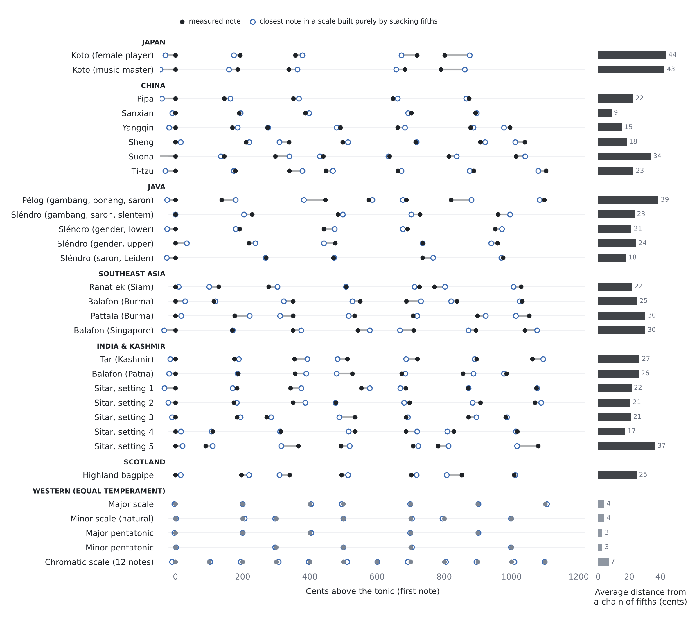

## Are universals in music rooted in physics?

In [Part 1](), we met Alexander Ellis, the 19th-century scholar who brought his tuning forks to a gamelan performance in a London aquarium. Ellis set out to measure musical scales across cultures, with the goal of testing a popular idea: that Western musical scales were derived from the laws of nature, and were therefore universal to all cultures.

For a modern version of this idea, here is the composer and conductor Leonard Bernstein in his 1973 Harvard lectures, _The Unanswered Question_[^1].  Here, he argued that the physics of sound is the common foundation of all music. He didn't claim that the Western scale was universal, only that it was built on the same physical laws as the music of every other culture.



Bernstein's argument goes like this: when a single note is played on an instrument like the piano, the string doesn't vibrate only at the frequency of the pitch we hear (the fundamental). Physics dictates that it also vibrates at integer multiples of that frequency. For example, the A above middle C vibrates at 440 Hz (440 times per second), but its sound also contains 880 Hz (the A an octave higher), 1320 Hz (an E), and so on. This is called the _harmonic series_. Bernstein claimed that it was the source of the simple ratios Pythagoras discovered, and that it could be used to derive the scales of many cultures, including those of the gamelan.

Apparently he never bothered to read Ellis's paper, published almost a century earlier... 

## The diversity of musical scales

After years of tireless data collection, Ellis came to this surprising conclusion:

> The Musical Scale is not one, not "natural", nor even founded 
> necessarily on the laws of the constitution of musical sound, 
> so beautifully worked out by Helmholtz, but very diverse, very 
> artificial, and very capricious.
>
> --- Alexander J. Ellis, "On the Musical Scales of Various Nations", 
> _Journal of the Society of Arts_, 1885

Today you'll find plenty of articles and videos showing how to play non-Western scales on a piano or guitar. They're handy, but they're only rough approximations, and they give the misleading impression that the world's scales are simply subsets of the Western one.  In his landmark 1885 paper, Ellis argued that the scales used in non-Western music are not corrupted or truncated versions of a universal Western scale. Rather, they deliberately contain intervals not found in Western music (see the Appendix at the end of this article for details).  

One striking example is an interval that sits between the major third and the minor third, the two intervals that give Western major chords their bright sound and minor chords their darker one.  This _neutral third_ is not a tuning error -- it's an aesthetic choice, giving the music a distinctive flavour that we tend to associate with the Middle East.



But the neutral third is not exclusive to the music of the Middle East.  Ellis was surprised when he heard it in the music of the Scottish Highlands and other places.  

Another important discovery is that musical scales are truly diverse, reflecting the aesthetics of each culture.  Take scales with five notes, or _pentatonic scales_, for example.  Although many cultures use five-note scales, there are different types of pentatonic scales, each with distinctive characteristics.  Ellis found a Chinese three-stringed lute ([Sanxian](https://en.wikipedia.org/wiki/Sanxian)) tuned to a scale that closely matches the major pentatonic scale (one of the scales used in blues), but you wouldn't mistake it for the Japanese [Hirajōshi](https://en.wikipedia.org/wiki/Hirajōshi_scale) scale.  The major pentatonic has no half steps (the smallest gap between piano keys), which gives it an open, sunny sound. The Hirajōshi includes two, which gives it a delicate, distinctly Japanese colour.

Europeans used to believe that five-note scales were so common outside the West because, they assumed, these "primitive" cultures had failed to develop an ear for fine intervals. Ellis's data told a different story.



In Ellis's famous words, musical scales are _diverse_, _artificial_ and _capricious_. To see what he meant by those provocative terms, let's return to the gamelan he measured at the Royal Aquarium.

## The strange tuning of gamelan

The crown jewel of Ellis's paper is the gamelan data from the Royal Aquarium. Unlike much of his collection, which relied on secondhand reports and museum pieces, it avoided the worst methodological problems. The instruments were in good condition and played by expert musicians, and the measurements were carefully repeated across several instruments in the ensemble. Most of his observations still hold up today.

Fig. 1 below shows the gamelan tunings Ellis measured. Each row under the "Java" heading shows one set of notes, in some cases averaged across several instruments.  Each note is plotted as its distance above the lowest note, measured in the cents we met in [Part 1](): an octave is 1200 cents, and a piano semitone is 100.  For most listeners, a difference of 20--30 cents already sounds noticeably out of tune.  Along the top, I've marked the frequency ratios of the intervals.  The three simplest, which are central to Western music theory, are marked with bold vertical lines: 2:1 (the octave), 3:2 (the perfect fifth) and 4:3 (the perfect fourth).

<figure style="margin: 2em 0;">
  
  <figcaption style="font-size: 0.9em; color: #6b7280; margin: 0.5em 0 0; text-align: center;">
    Fig. 1: Measured notes of gamelan instruments, shown as intervals (in cents) above the lowest note.  Some entries are averaged across multiple instruments.  The frequencies for Western scales are theoretical, not measured.  Note that they deviate from the simple integer ratios because the scales are in equal temperament. Data courtesy of the <a href="https://github.com/jomimc/DaMuSc">Database of Musical Scales</a>.
  </figcaption>
</figure>

First, diversity. Ellis observed that Javanese gamelan uses two entirely different tuning systems, called _sléndro_ and _pélog_. The instruments for the two systems are not interchangeable; each has its own repertoire, although a single performance can feature compositions from both systems.  There is very little overlap between the notes in the two systems.  _Sléndro_ is a pentatonic scale which roughly divides an octave into five equal parts, whereas _pélog_ is a seven-note system mixing very small and very big intervals. 
A piece doesn't use all seven; it draws on a five-note subset.

This is quite different from Western music, where all compositions are based on the same 12-note system (at least up to the late 19th century).  Most gamelan music is pentatonic, but its scales sound nothing like those of blues, folk music, or Chinese and Japanese music.



Next, artificiality. The two tuning systems must have seemed completely arbitrary to Ellis, because the notes didn't follow any rational principle known to Europeans at the time. In general, they don't line up with simple ratios. The perfect fourth and fifth, which Europeans hear as especially harmonious and which are central to Western music, are not obviously present. And _sléndro_ includes a note close to 7:4 above the lowest note (the harmonic seventh). It's a fairly simple ratio, yet one that Western music never uses.

Another head-scratcher is the octave. In Western music, a note and the "same" note an octave higher are always in a perfect 2:1 ratio: the higher one vibrates exactly twice as fast. On a gamelan, that isn't necessarily so. Strange as this seems to Western ears, Ellis found the same thing in other cultures, too.

Finally, capriciousness. Strictly speaking, _sléndro_ and _pélog_ are not scales in the Western sense; they are more like rough guides. Ellis compared his data with measurements of another gamelan, made in Leiden in the Netherlands. Within each ensemble, the instruments were tuned remarkably precisely to one another. But the two ensembles had noticeably different versions of _sléndro_ and _pélog_. Modern large-scale comparisons show that this variation is a defining feature of gamelan traditions in both Java and Bali[^2].

## Is it all culture?

So Bernstein was wrong: gamelan scales can't simply be derived from the harmonic series. Nearly a century before his lecture, Ellis had already shown that gamelan has more than one scale (diversity), that its intervals don't fit the ratios of Western theory (artificiality), and that its tunings aren't standardised (capriciousness).

Is it all culture, then? Not quite. Ellis's findings don't mean that the tunings of gamelan and other cultures are arbitrary cultural constructs with no bearing on the patterns of nature. The connection to nature just wasn't obvious in his day.  In [Part 3](), we'll dig deeper into the physics and perception of sound, and see how nature and nurture interact to create the diversity of the world's music.



## Appendix: Observations on Ellis's data

Ellis's 1885 paper tabulated a large number of scales from many sources.  Some are idealised scales taken from theoretical treatises. Here we look only at the scales that he and his correspondents measured directly from instruments[^3].

Fig. A1 is laid out like Fig. 1: each note is plotted as its distance in cents above the lowest note, with the frequency ratios marked along the top and the three simplest (2:1, 3:2 and 4:3) shown as bold lines. The Western scales at the bottom are in equal temperament, so they don't land exactly on these ratios, but the fourth and fifth come within about 2 cents, far too close for anyone to hear the difference.

<figure style="margin: 2em 0;">
  
  <figcaption style="font-size: 0.9em; color: #6b7280; margin: 0.5em 0 0; text-align: center;">
    Fig. A1: The measured intervals between notes and the lowest note from Ellis (1885). Western scales in this figure are theoretical, not measured.
  </figcaption>
</figure>

The measurements of the Chinese three-stringed lute, the [Sanxian](https://en.wikipedia.org/wiki/Sanxian), produced a pentatonic scale that closely matched simple ratios, but it's the exception, not the rule. Across the collection as a whole, notes show a weak tendency to cluster around the perfect fourth and fifth, but they very rarely land exactly on 2:1, 3:2 or 4:3. And as noted earlier, in several cultures the "octave" (the note where the scale starts over) isn't exactly double the frequency.

Neutral thirds, which fall between the major and minor third, are not uncommon in Ellis's data, which is at odds with the idea that musical intervals are built on simple ratios. And as we saw, _sléndro_ includes a note close to the harmonic seventh (7:4), a fairly simple ratio that is absent in Western music.

Fig. A2 offers a simple test of how far Ellis's scales stray from Western theory.  Ever since Pythagoras, the perfect fifth has been central to Western music.  Stack fifths on top of each other (C, G, D, A, E...) and you get a scale very close to the equal-tempered one familiar to modern ears.  The bottom rows of Fig. A2 show that the deviations here average only a couple of cents, which is undetectable to most people.  Most of Ellis's measurements, however, don't fit the Pythagorean model nearly as well: many deviate by more than 20 cents, enough to sound noticeably out of tune to Western listeners.

<figure style="margin: 2em 0;">
  
  <figcaption style="font-size: 0.9em; color: #6b7280; margin: 0.5em 0 0; text-align: center;">
    Fig. A2: The deviations of measured notes from theoretical scales constructed from the perfect fifth.  Western scales in this figure are theoretical, not measured.
  </figcaption>
</figure>

[^1]: Bernstein's argument wasn't original.  It was based on the theory of [Jean-Philippe Rameau](https://en.wikipedia.org/wiki/Jean-Philippe_Rameau), the 18th-century composer and theorist, combined with the [linguistics of Noam Chomsky](https://en.wikipedia.org/wiki/Universal_grammar).

[^2]: See, for example, [Balinese Gamelan Tuning: The Toth Archives](https://journal.iftawm.org/previous/vol9no2/vitale-sethares/), Vitale & Sethares (2021).

[^3]: For this exercise, I used a digitised version of Ellis's measurements from the [Database of Musical Scales](https://github.com/jomimc/DaMuSc), with some errors corrected.  Not every row comes from a single instrument: Ellis often listed values averaged across several.  Conversely, measurements from one instrument are sometimes split across several entries.  Nor is every entry strictly a scale; some are sets of notes from which scales are drawn, as with _pélog_. In this article, I use the word "scale" loosely.

