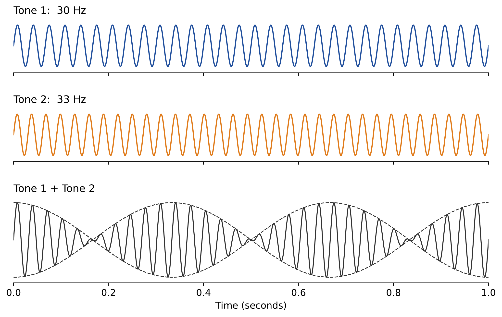
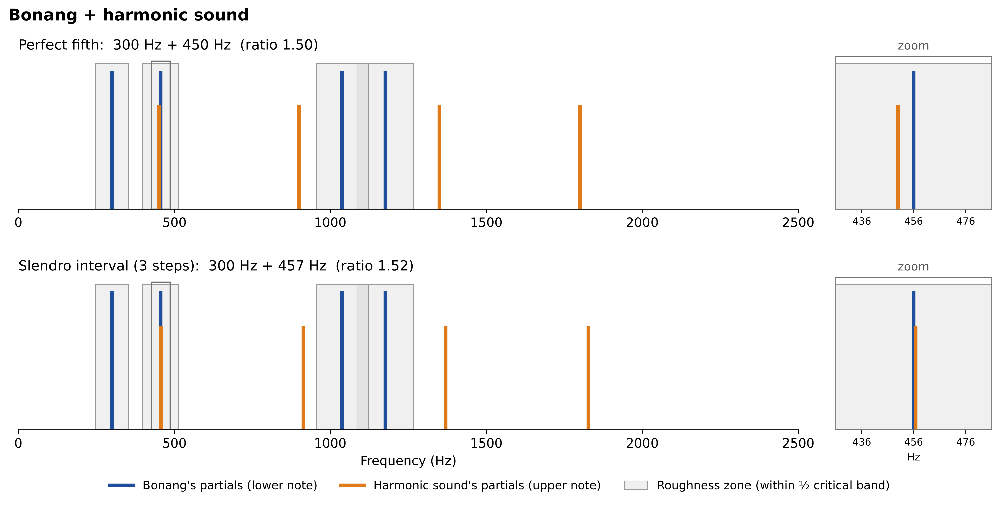

In [Part 1](), we saw that the West has a long tradition of attributing the beauty of music to the laws of physics or mathematics. The idea goes back to Pythagoras, and it rests on a simple observation: notes that sound harmonious together tend to have frequencies in simple ratios.

In [Part 2](), Ellis's data showed that most of the world's scales don't follow those ratios. To many 19th-century Europeans, that left two possible conclusions. Either Europeans had been the first to grasp music's natural laws, and other cultures would eventually catch up; or scales were purely cultural inventions, as arbitrary as any other custom. But there was a third possibility, and, ironically, it came from the very book Ellis had translated. In [_On the Sensations of Tone_](https://en.wikipedia.org/wiki/Sensations_of_Tone), [Hermann von Helmholtz](https://en.wikipedia.org/wiki/Hermann_von_Helmholtz) laid the foundations of the modern science of music perception. He argued that which intervals sound pleasant isn't dictated by mathematics. It emerges from the interaction between the physics of sound and the physiology of the human ear, and within those limits, each culture is free to make its own choices.

In this part of the series, we will use gamelan as an example to understand that Ellis's findings do not necessarily mean that non-Western scales are artificial or arbitrary. To see this, we have to go deeper into the nature of sound.

## A metal plate doesn't sound like a piano string

The sound of gamelan is so different from that of Western instruments that when Parisian musicians heard it at the 1889 World's Fair (the same fair where Debussy first encountered it), they couldn't agree on which notes they were hearing[^1]. Most gamelan instruments are bronze percussion: gongs, small kettle gongs, and metal keys struck with mallets. To Western ears, their metallic, ringing sound has an almost ethereal quality. Have a listen:

  <iframe style="flex:1 1 300px; aspect-ratio:16/9; border:0;"
          src="https://www.youtube-nocookie.com/embed/xJNGfPmjQLw"
          title="YouTube video" loading="lazy" allowfullscreen
          allow="accelerometer; autoplay; clipboard-write; encrypted-media; gyroscope; picture-in-picture"></iframe>
  <iframe style="flex:1 1 300px; aspect-ratio:16/9; border:0;"
          src="https://www.youtube-nocookie.com/embed/nZ74P-Rgvyg"
          title="YouTube video" loading="lazy" allowfullscreen
          allow="accelerometer; autoplay; clipboard-write; encrypted-media; gyroscope; picture-in-picture"></iframe>

To understand why this sound is so unusual, let's return to Bernstein's lecture. In this segment, he uses a piano to show that a single note contains many frequencies at once, the _harmonics_ we met in [Part 2](). Normally we don't hear them separately: our ears fuse them into a single sound, and together they give the note its _timbre_ (what makes a piano sound different from a violin playing the same note). But with the right technique, it's possible to bring them out one by one:



Let's look at this more closely using a guitar. The left panel of Fig. 1 below shows the frequencies that make up a single plucked note: a G, at 196 Hz. The height of each peak shows how strong that frequency is. Although we hear a single note, the sound also contains strong components at 392 Hz (2 × 196 Hz), 588 Hz (3 × 196 Hz), and so on. These neat whole-number multiples are no coincidence: they are what a vibrating string naturally produces. Bernstein believed that this harmonic series was the universal foundation of all music.

<figure style="margin: 2em 0;">
  
  <figcaption style="font-size: 0.9em; color: #6b7280; margin: 0.5em 0 0; text-align: center;">
    Fig. 1: Sample frequency spectra of the guitar compared to two gamelan instruments. The spectra are adapted from <i>Tuning, Timbre, Spectrum, Scale</i> (2nd ed.) by William Sethares (2005). Photos are from Wikipedia.
  </figcaption>
</figure>

Had Bernstein used gamelan instruments instead of a piano, he would have been in for a surprise. The middle and right panels of Fig. 1 show two of the main instruments of a Javanese gamelan: the _gender_, which has bronze keys suspended over bamboo resonators, and the _bonang_, a set of small bronze kettle gongs. Their spectra look very different from the guitar's. There is still a fundamental, but the higher components (called _partials_, since they are no longer true harmonics) are not whole-number multiples of it, and there are far fewer of them. There's nothing unnatural about this: solid metal bars and gongs simply vibrate differently from the stretched strings and columns of air in most Western instruments.

Sounds built on a harmonic series are called _harmonic sounds_; those that aren't are called _inharmonic sounds_. Helmholtz knew this distinction well. Using a set of tuned hollow spheres, now called [Helmholtz resonators](https://en.wikipedia.org/wiki/Helmholtz_resonance), he could pick out the individual frequencies in a sound by ear, and he found that many sounds, from bells to metal rods, are inharmonic. Yet he believed that inharmonic sounds were not truly musical, so _On the Sensations of Tone_, published in 1863, focused on harmonic sounds alone. The book appeared well before the first known gamelan performance in Europe, at the 1879 Colonial and National Trade Exhibition in Arnhem, the Netherlands. Had Helmholtz heard a gamelan, perhaps his research would have taken a different direction.

## The origin of simple integer ratios in Western music

There is a fundamental problem with attributing the beauty of music to the laws of nature. Even if musical intervals do follow precise mathematical ratios, why would we be able to hear them at all, and why would they sound beautiful? Most laws of nature are neither audible nor pleasing: we can't hear gravity, and no one finds the equations of motion beautiful to listen to. Attempts to explain it tend to end up either circular ("simple ratios sound good because simplicity is beautiful") or mystical, like Johannes Kepler's belief that the planets sing in harmony as they orbit the Sun.

Helmholtz broke out of this trap. In _On the Sensations of Tone_, he showed that what we hear as harmonious is closely tied to _consonance_. In his sense, this is not a musical judgement but a basic acoustic sensation: the smoothness or roughness we perceive whenever two sounds are heard together. And consonance, he argued, comes from two ingredients: the physics of sound, and the way our ears are built.

He started with physics (see Fig. 2 below). When two pure tones (like those of a tuning fork) are played together at slightly different frequencies, their sound waves interfere, and the combined sound swells and fades in volume. This is called _beating_, and its rate equals the difference between the two frequencies: tones at 440 and 443 Hz beat three times a second. Slow beating has a gentle pulsating effect that can be very pleasing[^2], but faster beating sounds harsh, or _rough_, in Helmholtz's term.

<figure style="margin: 2em 0;">
  
  <figcaption style="font-size: 0.9em; color: #6b7280; margin: 0.5em 0 0; text-align: center;">
    Fig. 2: Two simple tones (sinusoidal waves) with different frequencies create beating, a regular rise and fall in loudness.
  </figcaption>
</figure>

When two musical notes are played together, things get much more complicated. Each note is made up of a whole series of harmonics, so every harmonic of one note can beat against every harmonic of the other. Wouldn't that sound chaotic? This is where physiology comes in. Helmholtz argued that the inner ear works like a bank of tiny detectors (or _frequency filters_, in technical terms), each responding only to a narrow range of frequencies. Two harmonics can only produce audible roughness if they fall within the same detector. If they are far apart, each detector hears just one of them, and nothing clashes. So to judge how consonant an interval sounds, we only need to look at harmonics that land close together.

Fig. 3 shows how this explains the consonance of the perfect fifth, two notes whose frequencies are in a 3:2 ratio. After the unison (1:1) and the octave (2:1), it is the most consonant interval in Western music. In the upper panel, the blue lines are the harmonics of a note at 300 Hz, and the orange lines are those of a note at 450 Hz. Both are harmonic sounds, so each note's harmonics are evenly spaced[^3]. The grey boxes mark the range of a single detector around each blue harmonic, known as the _critical band_; the zoom panel on the right enlarges the region around 900 Hz.

<figure style="margin: 2em 0;">
  
  <figcaption style="font-size: 0.9em; color: #6b7280; margin: 0.5em 0 0; text-align: center;">
	Fig. 3: Consonant (upper panel) vs. dissonant (lower panel) intervals of harmonic sounds, according to Helmholtz's theory. Blue lines are the harmonics of the lower note; orange lines, the upper note. Grey boxes mark the range of a single detector around each harmonic of the lower note. The zoom panels enlarge the region around 900 Hz.
  </figcaption>
</figure>

Now look closely at where the blue and orange lines fall. Most of them don't line up, but the mismatched pairs are mostly far apart, so they don't fall within the same critical band and don't clash. And where the two notes' harmonics do land close together, they line up exactly: 900 Hz is both 3 × 300 and 2 × 450, and the same is true at 1800 Hz. So there's little or no beating. This, according to Helmholtz, is why the perfect fifth sounds so consonant. He applied the same logic to other intervals and found a general rule: the simpler the ratio between two notes, the more often their harmonics coincide exactly, and the fewer near-misses produce roughness.

The lower panel of Fig. 3 shows what happens when a Western instrument plays an interval from the _sléndro_ scale: 300 Hz and 457 Hz, a ratio of 1.52, only slightly wider than a perfect fifth. Now the near-misses fall within the same critical band. In the zoom panel, the harmonics at 900 and 914 Hz are 14 Hz apart, so they beat 14 times a second, which is well into the rough range. That's why a _sléndro_ interval played on a Western instrument sounds less consonant than a perfect fifth.

In other words, there is nothing magical about simple ratios. They sound consonant only because the instruments that play them produce harmonic sounds. Change the sound, and you change which intervals are consonant.

## The acoustic basis of gamelan scales

As we've seen, Helmholtz restricted his analysis to the harmonic sounds of Western music. It would take more than a century for modern researchers, aided by computers, to pick up where he left off. Fig. 4 shows a simplified version of a study by William Sethares[^4]. He looked at what happens when the inharmonic sound of the _bonang_ (see Fig. 1) is played together with a harmonic sound, such as a human voice or a bowed string instrument. This combination is common in Javanese gamelan; listen to _Puspawarna_ in [Part 1]() again to hear it.

The result is a mirror image of Fig. 3. With the _bonang_ as the lower note, it's now the perfect fifth that clashes: the _bonang_'s partial at 456 Hz sits just 6 Hz from the upper note at 450 Hz, close enough to beat. The _sléndro_ interval, by contrast, places the upper note at 457 Hz, almost exactly on top of that partial. So Helmholtz's theory predicts that, with gamelan instruments, the _sléndro_ interval sounds more consonant than the perfect fifth, even though its ratio is not a simple one.

<figure style="margin: 2em 0;">
  
  <figcaption style="font-size: 0.9em; color: #6b7280; margin: 0.5em 0 0; text-align: center;">
	Fig. 4: The same two intervals as in Fig. 3, but with the lower note played on a <i>bonang</i> (blue) and the upper note a harmonic sound (orange). Now the perfect fifth (upper panel) is rougher than the <i>sléndro</i> interval (lower panel). Based on the model of William Sethares.
    </figcaption>
</figure>

Sethares then used a computer program to search for the most consonant intervals for the _bonang_'s sound, and the scale it produced closely approximates _sléndro_. The scale, it seems, is not so arbitrary after all.

So far, this is all theory. Do people actually hear the difference? In a 2024 study, Marjieh and colleagues asked participants to rate how pleasant different intervals sounded (a common way to measure consonance), using both harmonic sounds and inharmonic, gamelan-like ones[^5]. With the gamelan-like sounds, participants preferred some _sléndro_ intervals over the perfect fifth. Since they had little or no exposure to gamelan, the result can't be explained by familiarity. It's a beautiful demonstration of one of Helmholtz's most important insights: consonance depends on the sound.

Of course, this doesn't explain everything about gamelan tuning. We haven't looked at the more complicated _pélog_ system, at the other instruments of the ensemble, or at why tunings vary so much from one gamelan to the next. But it gives us good reason to think that at least some aspects of gamelan tuning are not as arbitrary as Ellis believed.

## Where does diversity in music come from?

Let's revisit Ellis's conclusion, which we have already seen in [Part 2]():

> The Musical Scale is not one, not "natural", nor even founded
> necessarily on the laws of the constitution of musical sound,
> so beautifully worked out by Helmholtz, but very diverse, very
> artificial, and very capricious.
>
> --- Alexander J. Ellis, "On the Musical Scales of Various Nations",
> _Journal of the Society of Arts_, 1885

As the translator of _On the Sensations of Tone_, Ellis knew Helmholtz's theory intimately, yet he concluded that his findings contradicted it. That seems an overreaction, especially since Helmholtz had written, in a passage Ellis himself translated:

> Just as little as the gothic pointed arch, should our diatonic major
> scale be regarded as a _natural product_. At least such an expression is
> quite inapplicable, except in so far as both are necessary and _natural_
> consequences of the principle of style selected.
>
> --- Hermann von Helmholtz, _On the Sensations of Tone_, Part III, Chapter XIII

In other words, a Gothic arch must obey the laws of physics or it will fall down, but physics didn't choose the pointed shape. In the same way, Helmholtz saw his theory as setting the acoustic limits within which each culture shapes its own music.  Yet Victorian scholars couldn't resist reading _On the Sensations of Tone_ as a scientific justification of Western music.

So why doesn't Helmholtz's theory rule out diversity? First, because consonance depends on the physical characteristics of the sound, different instruments favour different intervals. Some of the world's musical diversity simply reflects the variety of sounds people make music with: strings, voices, bamboo, bronze. Scholars in the 19th century, Helmholtz included, underestimated just how varied those sounds could be.

Second, musical pleasure is not the same thing as acoustic consonance. For Western listeners, the intervals people find pleasant closely track consonance[^6], but this isn't universal. A team led by Josh McDermott found that the Tsimane', an Indigenous people of the Bolivian Amazon with little exposure to Western music, rated consonant and dissonant chords as roughly equally pleasant[^7]. Balinese gamelan offers another example. Its instruments come in pairs, one tuned slightly higher than the other, so that together they produce the slow, shimmering beating we met earlier. Balinese musicians call it _ombak_ ("waves"). What Western tuning treats as a flaw to be avoided, Balinese musicians cultivate as a source of beauty.

In the essay "[Shakespeare in the Bush](https://www.naturalhistorymag.com/picks-from-the-past/12476/shakespeare-in-the-bush)", the anthropologist Laura Bohannan recalls a friend's warning before her fieldwork in Africa: "one can easily misinterpret the universal by misunderstanding the particular." It's an easy trap, and the 19th-century debate shows why. With only the harmonic sounds of Western instruments to go on, it was natural to mistake them for universal laws, and just as natural, once the gamelan broke those laws, to conclude there were none. 

## A humanist point of view on universality

We began this series in [Part 1]() by asking whether an alien civilisation could appreciate the music on Voyager's golden record. Helmholtz's answer would be: probably not in the way we do. Consonance arises where the physics of sound meets the physiology of the human ear, and that ear was shaped by our own evolutionary history. If our critical bands were wider or narrower, different intervals would sound smooth or rough, and the music built on them would sound different too. Add the cultural traditions that shape what each of us finds beautiful, and it seems likely that the music on the record -- the _Brandenburg Concerto_, _Puspawarna_, _Johnny B. Goode_ -- was made for human ears alone.

Here on Earth, what we have learned from Helmholtz is a humanist understanding of universality that is broad enough to embrace the diversity of music across all cultures.  _Puspawarna_ may never reach an alien listener, but for anyone with human ears, it is an invitation to learn to listen.



[^1]: See [Sundanese Reverberances: Untangling Contradictions about the Gamelan Spectacle at the 1889 Paris World's Fair](https://academic.oup.com/ml/article/106/1/58/7931576), López-Lara & Chiantore (2025).

[^2]: The pleasant pulsating effect of slow beating is used to great effect in Balinese gamelan. It's called _ombak_ (meaning "waves" in Indonesian).

[^3]: In real instruments, higher harmonics are usually weaker. In Figs. 3 and 4, all harmonics of a note are drawn at the same height for simplicity, and the upper note is drawn shorter so the two are easier to tell apart.

[^4]: See the textbook _Tuning, Timbre, Spectrum, Scale_ (2nd ed.) by William Sethares (2005).

[^5]: See [Timbral effects on consonance disentangle psychoacoustic mechanisms and suggest perceptual origins for musical scales](https://www.nature.com/articles/s41467-024-45812-z), Marjieh et al. (2024).

[^6]: Closely, but not exactly: the study cited in footnote 5 found that the intervals participants rated most pleasant deviated slightly from the most consonant ones.

[^7]: See [Indifference to dissonance in native Amazonians reveals cultural variation in music perception](https://www.nature.com/articles/nature18635), McDermott et al. (2016).
