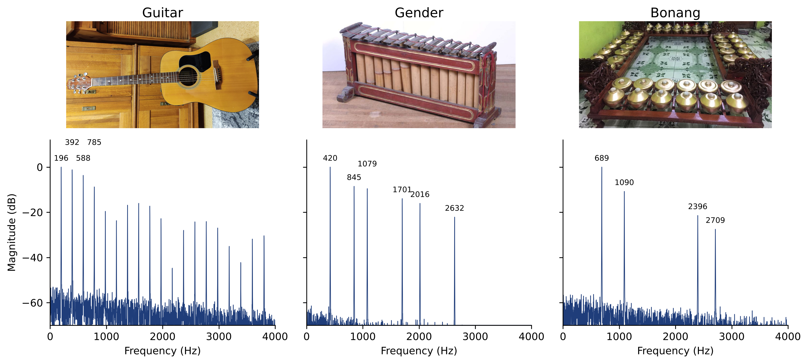
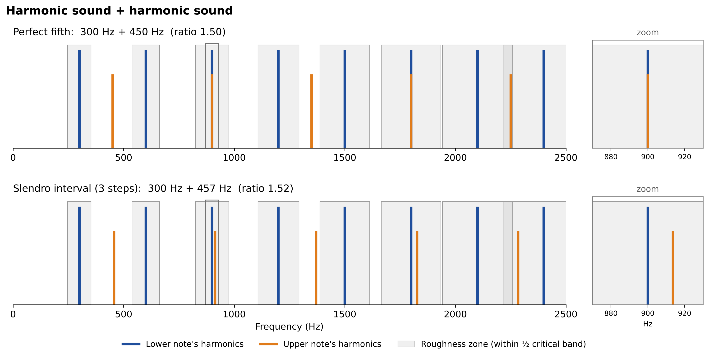

In [Part 1]() of this series, we saw that in the West, there is a long intellectual history of attributing the beauty of music to laws of physics of mathematics.  This is primarily motivated by the observation that notes that sound harmonious together seem to have frequencies in simple integer relationships.  

Alexander Ellis, however, observed that the simple integer ratio relationships are, in general, not followed across different cultures.  One possible explanation is that the Europeans are the first to develop the intellectual sophistication to create music that mirrors the universal laws in mathematics and physics, and therefore, non Western music will eventually converge to Western music as their cultures progress, or at least develop music with extensive overlap with Western music.  Another interpretation is that music scales around the world are fundamentally different, and scales can be as arbitrary as any cultural practices.

At a glance, it appears to many that these two views are the only possible explanations, but even the 19th century, scientists such as Hermann von Helmholtz already started the development of the modern science of music perception, which emphasises that pleasant intervals in music are not fixed.  Rather, they are the outcome of the interactions among the physics of sound, the physiology of the hearing, and other factors.  The implication is that if there is universal in music, it is human perception.

In this part of the series, we will use gamelan as an example to understand that Ellis' findings do not necessarily mean that non Western scales are artificial or arbitrary. To see this, we have to go deeper into the nature of sounds.

## A metal plate doesn't sound like a piano string

The sound of gamelan is so fundamentally different from Western music that when Parisian musicians encountered gamelan in the 1889 World’s Fair (the same exposition that exposed Debussy to gamelan), they couldn't agree on the identity of the notes that they heard[^1].  Gamelan instruments are primarily (but not exclusively) percussive instruments made with bronze.  For Western listeners, there is an ethereal quality to its metallic, ringing sound.

  <iframe style="flex:1 1 300px; aspect-ratio:16/9; border:0;"
          src="https://www.youtube-nocookie.com/embed/xJNGfPmjQLw"
          title="YouTube video" loading="lazy" allowfullscreen
          allow="accelerometer; autoplay; clipboard-write; encrypted-media; gyroscope; picture-in-picture"></iframe>
  <iframe style="flex:1 1 300px; aspect-ratio:16/9; border:0;"
          src="https://www.youtube-nocookie.com/embed/nZ74P-Rgvyg"
          title="YouTube video" loading="lazy" allowfullscreen
          allow="accelerometer; autoplay; clipboard-write; encrypted-media; gyroscope; picture-in-picture"></iframe>

To understand why this sound is so unusual, let's return to Bernstein's lecture mention in [Part 2]().  In the following segment from his lecture, he used a piano to demonstrate that a single piano note multiple frequencies called _harmonics_.  We don't hear the individual harmonics normally, because they are fused together to be perceived as the timbre of the note, but with proper technique[^2], it's possible to amplify them individually so they become audible:



Let's use the sound of the guitar as our example to look at this phenomenon in more detail.  The left panel of Fig. 1 below visualizes vibrations at different frequencies that make up the sound of a single plucked note.  The y-axis shows the amplitude (i.e. the strength) of each frequency.  The figure shows that the sound is dominated by a number of strong components, so although it is perceived as a single sound of 196 Hz, it is composed of frequencies at 392 Hz (2x of 196 Hz), 588 Hz (3x of 196 Hz)... and so on.  The component with the lowest frequency is called the fundamental, and the other components are called harmonics. Togther, they are called the harmonic series.  The fact that the frequencies are integer multiples of the fundamental seems mysterious, but it is dictated by the laws of physics.  According to Bernstein, the harmonic series is universal to all music.

<figure style="margin: 2em 0;">
  
  <figcaption style="font-size: 0.9em; color: #6b7280; margin: 0.5em 0 0; text-align: center;">
    Fig. 1: Sample frequency spectra of the guitar compared to two gamelan instruments. The spectra are adapted from <i>Tuning, Timbre, Spectrum, Scale</i> (2 eds.) by William Sethares (2005). Photos are from the Wikipedia.
  </figcaption>
</figure>

If Bernstein had used gamelan instruments instead of the piano in his demonstration, he'd be very surprised!  The middle and the right panels of Fig. 1 illustrate two main instruments in a Javanese gamelan: a _gender_ and a _bonang_.  The gender is an instrument with bronze keys amplified by bamboo resonantors, and the bonang is a set of small bronze kettle gongs. Both are percussive instruments played by mallets.  The compositions of the sounds are very different from that of the guitar.  There are still fundamental and harmonics, but they are no longer in integer relationships.  Also, the number of harmonics is much smaller than the number of harmonics in the guitar.  There is nothing strange about this sound: it's just the consequence of the physics of the vibration of metal plates.  

This distinction is important.  Sounds composed of harmonic series are called _harmonic sounds_. Those that are not are called _inharmonic sound_. 

In the 19th century, the German physiologist and physicst [Hermann von Helmholtz](https://en.wikipedia.org/wiki/Hermann_von_Helmholtz) invented a [scientific instrument](https://en.wikipedia.org/wiki/Helmholtz_resonance) to study the composition of sounds.  By 1863, he had already demonstrated that harmonic sounds are rare in nature.  However, he believed that inharmonic sounds are not musical, and therefore devoted his magnum opus [_On the Sensations of Tone_](https://en.wikipedia.org/wiki/Sensations_of_Tone) to the perception of harmonic sounds.  This research was done before the first known gamelan performance in Europe (in the 1879 Colonial and National Trade Exhibition in Arnhem).  If Helmholtz had the opportunity to hear a gamelan performance, perhaps his research would have taken a different direction.

## The origin of simple integer ratios in Western music
There is a fundamental problem in attributing the beauty in music to the laws of nature: even if musical intervals do follow precise mathematical relationship, why is this relationship perceived as beautiful or harmonious by the human mind? After all, nature laws are in general not intuitively perceivable.  Further, even if we can perceive natural laws, why are these relationships perceived as beautiful or pleasant?  After all, natural laws are not inherently pleasing.  It's difficult to not fall into the traps of circular reasoning or mysticism in this direction.

Hermann von Helmholtz broke out of this trap in his landmark book _On the Sensations of Tone_, by showing that pleasant and harmonious relationships in music are closely related to an acoustic sensation, which comes out of the interaction between the physics of sound and the physiology of the human auditory system.  He started with physics: if two sinusoidal waves with slightly different frequencies are played simultaneously, the two waveforms interact, resulting in modulation of amplitude - a phenomenon called _beating_. Low frequency beating has a pulsating effect that can be very pleasing[^3]. High frequency beating, on the other hand, is unpleasant (or _rough_, in Helmholtz' term). 

<figure style="margin: 2em 0;">
  
  <figcaption style="font-size: 0.9em; color: #6b7280; margin: 0.5em 0 0; text-align: center;">
    Fig. 2: Two simple tones (sinusoidal waves) with different frequencies creates beating - modulations in amplitude.
  </figcaption>
</figure>

The figure above illustrates beating created by playing two pure tones simultaneously.  When two musical notes are played simultaneously, the situation is much more complicated. Since each note is composed of a series of harmonics, every pair of harmonics between the two notes can interact, resulting in an enormously large number of beating waves, all superimposed together.  Wouldn't that sound chaotic?  This is where physiology comes in.  Helmholtz argued that neurons in the inner ear are organized like a set of detectors (or _frequency filters_ in technical terms), each responding only to sound waves within a certain frequency range.  To analyze the consonance of an interval, as experienced by the listener, we therefore only have to consider harmonics that fall into the range of a single detector.

The following figure illustrates why in Western music, the perfect 5th (where the frequencies of two notes are in 3:2 relationship) is perceived as a pleasing consonant interval.  In fact, it is considered the most consonant interval in Western music besides unison and octave, because 3:2 is the simplest ratio besides 1:1 and 1:2).  The upper panel uses two different colors to illustrate the components of musical notes.  The ones colored in blue is a note with the fundamental frequency of 300 Hz, while the other, colored in orange, is a higher note with the fundamental frequency at 450 Hz.  Since both sounds are made with Western instruments, the harmonics of each sound are evenly spaced, forming a harmonic series[^4].  

Now pay close attention to the alignment of pairs of harmonics across the two notes.  The blue and the orange vertical lines are usually not aligned.  If we are only considering the physics of sound, the misalignments will create unpleasant beating.  However, the misaligned pairs are far apart in their frequencies, so that they do not fall into the range of a single detector.  The misalignments are therefore not perceived.  Importantly, when the harmonics of the two notes fall into the window of a filter, they are perfectly aligned, creating no beating as well.  This is why, according to Helmholtz, the perfect 5th is so consonant.  Helmholtz applied the same logic to other intervals, and demonstrated that the consonance of a music interval in Western music can be explained this way: Simpler integer ratios are associated with intervals that are acoustically consonant, because the harmonics that fall into the same detector's range are more aligned.

<figure style="margin: 2em 0;">
  
  <figcaption style="font-size: 0.9em; color: #6b7280; margin: 0.5em 0 0; text-align: center;">
    Fig. 3: Consonant (upper panel) vs. dissonant (lower panel) intervals of harmonic sounds, according to the physiological theory of Helmholtz.  The harmonics of the two notes, in colored in blue and the other in orange, are indicated by the vertical line segments.
  </figcaption>
</figure>

The lower panel of Fig. 3 illustrates a Western instrument playing two notes in an interval of the sléndro scale.  In this setting, there are misaligned pairs that fall into the frequency range of a detector.  The interaction creates perceivable beating, which is why a gamelan interval played on a Western instrument does not sound pleasing.

Importantly, in this theory, there is nothing inherently pleasing about simple integer ratios. They are consonant only if the sound is harmonic. If the sound is inharmonic, consonant intervals would be different.

## The acoustic basis of gamelan scales
As mentioned earlier, Helmholtz restricted his analyses of musical intervals to harmonic sound used in Western music. It would take more than a century for modern researchers, added by computers, to pick up where Helmholtz left off.  Fig. 4 below illustrates a simplified version of a study of William Sethares[^5], where he examined a scenario where the inharmonic sound of the Bonang (see Fig. 1) is played simultaneously with the harmonic sound of the human voice of a string instrument - which is common in Javanese gamelan (listen to _Puspawarna_ in [Part 1]() again to experience the sound).  The perceived consonance is now reversed: it's the perfect 5th interval, with the simple integer of 3:2, that has misaligned harmonics (see the upper panel).  An interval in the sléndro (see the lower panel) now has smaller misalignment.  Helmholtz' theory, therefore, predicts that in gamelan, the sléndro interval sounds more consonant, even though the frequencies are not a simple integer ratio.  Sethares used a computer program to look for intervals that sound most consonant, and was able to produce a scale that approximate sléndro, suggesting that it is not arbitrary, after all.

<figure style="margin: 2em 0;">
  
  <figcaption style="font-size: 0.9em; color: #6b7280; margin: 0.5em 0 0; text-align: center;">
    Fig. 4: Consonant vs. dissonant intervals of an inharmonic sound (played on the Bonang, indicated by blue) and a harmonic sound (indicated by orange), according to the computation theory of William Sethares.
  </figcaption>
</figure>

This argument appears to be highly theoretical.  Do people actually hear the difference?  In recent years, a group of psychologists asked participants in an experiment to judge the pleasantness of intervals using inharmonic and harmonic sounds (similar to Sethares' computational modeling)[^6].  The result was that the participants preferred some of the sléndro intervals over the prefect 5th.  The participants in this study had no exposure to gamelan, so this result cannot be attributed to familiarity with the intervals used in gamelan.  This is a beautiful demostration of one of Helmholtz' most important insights: consonance is dependent on the sound.  

The above does not explain everything about gamelan. We haven't looked into the more complicated pelog tuning, we haven't considered other gamelan instruments... and so on, but it gives us sufficient reason to believe that at least some aspects of gamelan's tuning isn't as arbitrary as Ellis thought.

## Conclusions

By the end of the 19th century, Europeans started 



[^1]: See [Sundanese Reverberances: Untangling Contradictions about the Gamelan Spectacle at the 1889 Paris World’s Fair](https://academic.oup.com/ml/article/106/1/58/7931576?guestAccessKey=c3e2c6b8-cf1f-4361-b34c-b00bd38da122&login=false), López-Lara & Chiantore (2025).

[^2]: The technique that Bernstein used in the demonstration was pioneered by Hermann von Helmholtz in his study of musical pereception.

[^3]: The pleasant pulsating effect of slow beating is used to great effects in Balinese gamelan. It's called _ombak_ (meaning "waves" in Indonesian).

[^4]: In real instruments, the amplitudes of harmonics decrease with frequency.  In this figure, the amplitudes of the harmonics of the same note are the same for simplicity.  Also, the amplitudes of the higher note is smaller to make them more distinguishable in the figure.

[^5]: See the texbook _Tuning, Timbre, Spectrum, Scale_ (2 eds.) by William Sethares (2005).

[^6]: See _Timbral effects on consonance disentangle psychoacoustic mechanisms and suggest perceptual origins for musical scales_, Marjieh _et al._ (2024) [[link](https://www.nature.com/articles/s41467-024-45812-z)]
